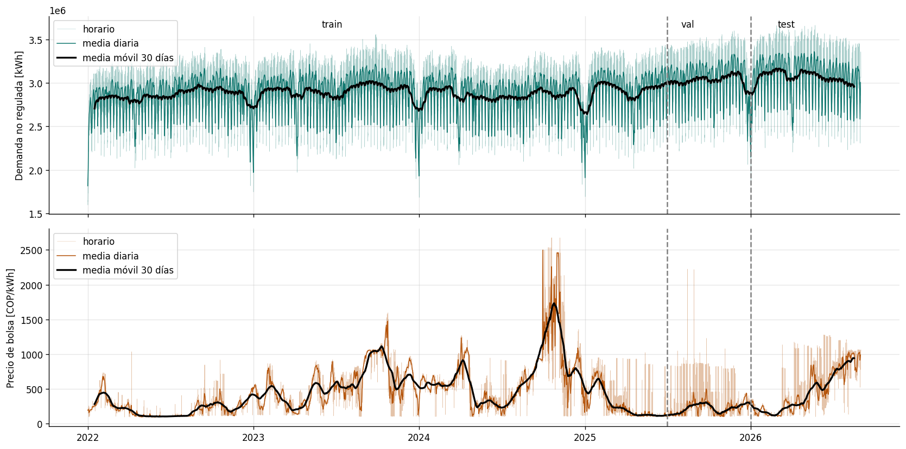
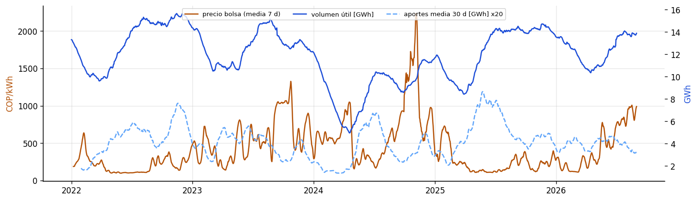
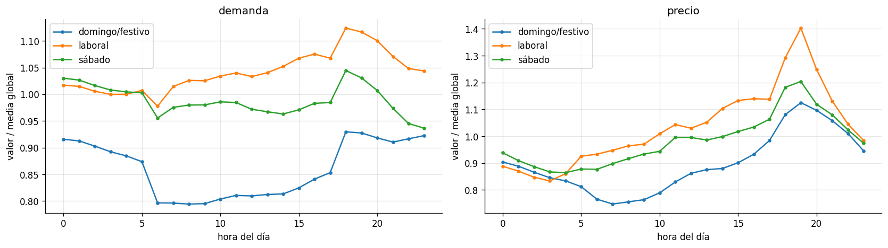
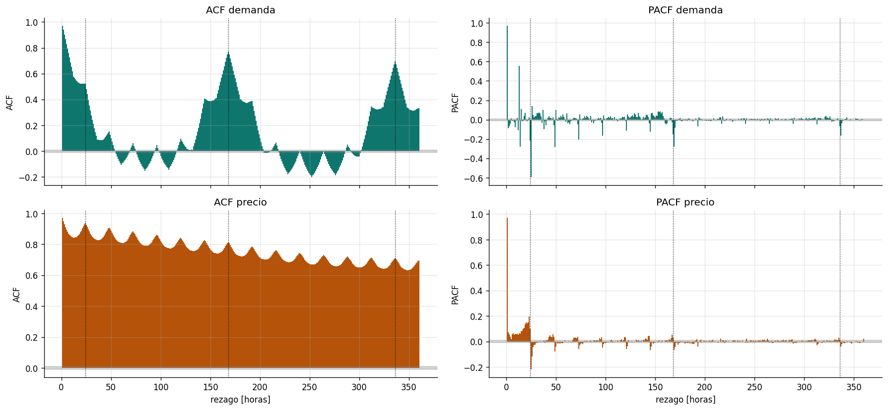
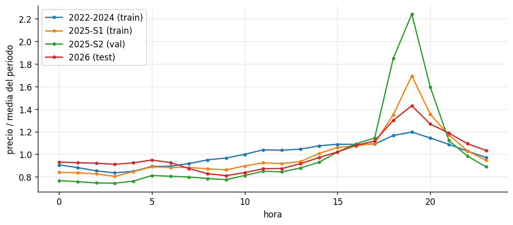
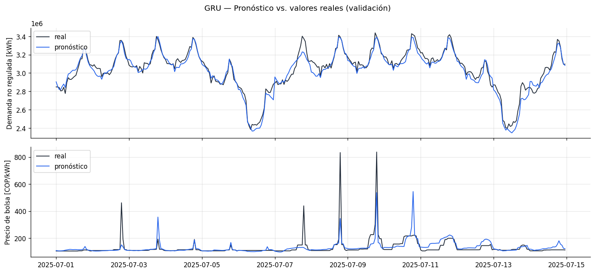

```{=html}
<style>
.ganador { border: 2px solid #f59e0b; border-radius: 8px; padding: 1.2em 1.5em; background: #fffbeb; margin: 1.5em 0; }
.ganador h3 { margin-top: 0.2em; }
.cifras { display: flex; flex-wrap: wrap; gap: 12px; margin: 1.2em 0; }
.cifra { flex: 1 1 150px; border: 1px solid #e5e7eb; border-radius: 6px; padding: 0.7em 0.9em; background: #ffffff; }
.cifra .v { font-size: 1.6em; font-weight: 600; color: #b45309; line-height: 1.2; }
.cifra .l { font-size: 0.85em; color: #4b5563; }
</style>
```

# Resumen

Este proyecto pronostica, para las **24 horas del día siguiente**, la **demanda de energía de los usuarios no regulados** y el **precio de bolsa nacional** del mercado eléctrico colombiano. Es un problema de regresión multivariada sobre series de tiempo, resuelto con aprendizaje supervisado y redes neuronales profundas en PyTorch, con datos horarios de XM entre enero de 2022 y agosto de 2026.

El trabajo se hizo en tres fases:

| Fase | Qué se hizo | Resultado principal |
|---|---|---|
| **1. Datos** | Descarga, estandarización, análisis estadístico, *feature engineering*, pipeline y líneas base | Dataset de 40.704 horas × 16 variables y una meta: superar al naive semanal en demanda (3,83 %) y al naive diario en precio (20,34 %) |
| **2. Modelamiento** | Cinco arquitecturas entrenadas con la misma configuración: RNN, TCN, GRU, LSTM y Transformer | Pasan a optimización la GRU (23,55 % de MAPE de precio) y la TCN (27,43 %) |
| **3. Optimización** | Ocho optimizadores, regularización, variantes de arquitectura y tres semillas para cada una de las dos redes | La **GRU optimizada** es el modelo final: 2,04 % de MAPE de demanda y 20,90 % de precio en validación |

| Integrante | Fase 2 | Fase 3 |
|---|---|---|
| Esteban Daza Palomino | RNN | TCN |
| Sara Jurado Giraldo | TCN | |
| Isabel Suárez Londoño | GRU | GRU |
| Kevin González Duarte | LSTM | |
| Stiven Saldarriaga Mayorga | Transformer | |

El modelo ganador y su aplicación en la industria están en la sección [-@sec-ganador].

# Contexto y planteamiento del problema {#sec-problema}

## El mercado eléctrico colombiano

En el Mercado de Energía Mayorista (MEM) los comercializadores y los grandes consumidores compran energía por dos vías: **contratos bilaterales** de largo plazo, con precio pactado, y la **bolsa de energía**, donde se liquida cada hora la energía que no quedó cubierta por contratos, al **precio de bolsa**. XM S.A. E.S.P. opera el sistema, administra el mercado y publica la información operativa y comercial.

La generación del país es mayoritariamente **hidráulica**, así que el estado de los embalses y los aportes de los ríos condicionan la oferta y el precio. En los periodos secos, asociados al fenómeno de El Niño, el precio de bolsa puede multiplicarse varias veces en pocas semanas.

## Usuarios no regulados

Un **usuario no regulado** tiene una demanda máxima superior a 0,1 MW o un consumo mensual superior a 55 MWh (Resolución CREG 131 de 1998). Son, sobre todo, industrias y grandes comercios que negocian libremente el precio de su energía. Enfrentan dos incertidumbres a la vez: su propia demanda, que depende de la producción y del calendario, y el precio de bolsa, que depende de la hidrología. Anticipar las dos hora a hora es la base de cualquier estrategia de compra de energía.

## Formulación

A las 00:00 del día $D+1$, con la información disponible hasta ese momento, se pronostican las 24 horas de ese día:

$$
\widehat{\mathbf{Y}}_{D+1} =
\begin{bmatrix}
\widehat{D}_{t_0} & \widehat{P}_{t_0} \\
\vdots & \vdots \\
\widehat{D}_{t_0+23} & \widehat{P}_{t_0+23}
\end{bmatrix}
= f\big(\mathbf{X}_{t_0-168\,:\,t_0},\; \mathbf{C}_{t_0\,:\,t_0+24};\; \mathbf{w}\big) \in \mathbb{R}^{24\times 2}
$$

donde $\widehat{D}_t$ es la demanda no regulada [kWh], $\widehat{P}_t$ el precio de bolsa [COP/kWh], $\mathbf{X}$ las últimas 168 horas de 16 variables, $\mathbf{C}$ el calendario de las 24 horas a pronosticar (9 variables) y $\mathbf{w}$ los pesos de la red. Los pesos se obtienen minimizando el error cuadrático medio sobre las salidas estandarizadas:

$$
\min_{\mathbf{w}} \; \mathcal{L}(\mathbf{w}) = \frac{1}{N}\sum_{i=1}^{N} \frac{1}{48}\left\lVert \mathbf{Y}_i - \widehat{\mathbf{Y}}_i \right\rVert_F^2
$$

Las métricas se reportan en unidades originales: MAE, RMSE, MAPE y R² de cada serie.

# Fase 1 · Datos {#sec-fase1}

## Fuente y variables

Todos los datos vienen de la API pública de XM, consultada con el paquete `pydataxm`. Son métricas agregadas del sistema, sin información de usuarios individuales.

| Variable | Métrica XM | Resolución | Unidad | Rol |
|---|---|---|---|---|
| Demanda comercial no regulada | `DemaComeNoReg` | horaria | kWh | **objetivo** |
| Precio de bolsa nacional | `PrecBolsNaci` | horaria | COP/kWh | **objetivo** |
| Precio promedio de contratos, mercado no regulado | `PrecPromContNoRegu` | horaria | COP/kWh | exógena |
| Aportes hídricos en energía | `AporEner` | diaria | kWh | exógena |
| Volumen útil diario de embalses en energía | `VoluUtilDiarEner` | diaria | kWh | exógena |

El periodo va del 1 de enero de 2022 al 31 de agosto de 2026: 1.704 días o 40.896 horas, sin horas faltantes, duplicadas ni valores nulos después de la estandarización.

## Pipeline de datos

```{mermaid}
flowchart LR
    A[(API XM)] -->|xm.py| B[data/raw<br/>5 CSV]
    B -->|preprocesamiento.py| C[data/interim<br/>40.896 × 5]
    C -->|features.py| D[data/processed<br/>40.704 × 16]
    D -->|dataset.py| E[Ventanas<br/>pasado · futuro · y]
    E --> F[Redes<br/>neuronales]
```

1. **Estandarización.** Las métricas horarias pasan del formato ancho de XM (día × 24 horas) a una serie horaria, y todo se reindexa contra un calendario horario completo. Cada valor diario se repite en las 24 horas de su día.
2. ***Feature engineering*.** Se agregan la media de 7 días de los aportes, la diferencia de 7 días del volumen útil y nueve variables de calendario: seno y coseno de la hora, del día de la semana y del día del año, más `es_festivo`, `es_sabado` y `es_domingo_o_festivo`. Los festivos se calculan con la Ley 51 de 1983.
3. **Escalado.** `log1p` y z-score para el precio y los aportes, que son muy asimétricos; z-score para el resto. Las medias y desviaciones se calculan solo con entrenamiento.
4. **Ventanas y partición.** Cada ejemplo tiene 168 horas de historia y 24 de horizonte, y la partición es cronológica.

::: {.callout-important}
## Sin fuga de información

Los aportes y el volumen útil de un día solo se conocen cuando el día termina. Por eso, en todas las horas del día $d$ se usa el valor del día $d-1$. El cuaderno de *feature engineering* verifica que se cumpla en cada hora.
:::

| Tensor | Forma | Contenido |
|---|---|---|
| `pasado` | (N, 168, 16) | Las últimas 168 horas de las 16 variables, escaladas |
| `futuro` | (N, 24, 9) | El calendario de las 24 horas a pronosticar |
| `y` | (N, 24, 2) | Demanda y precio de esas 24 horas, escalados |

| Partición | Periodo | Muestras | Uso |
|---|---|---|---|
| Entrenamiento | 2022-01-16 a 2025-06-30 | 30.265 | Ajustar los pesos (una ventana por hora) |
| Validación | 2025-07-01 a 2025-12-31 | 184 | *Early stopping* y todas las decisiones |
| Prueba | 2026-01-01 a 2026-08-31 | 243 | Solo para reportar al final |

## Análisis Estadístico



- **El precio se mueve por regímenes hidrológicos.** Pasó de 216 COP/kWh en promedio en 2022 a 676 en 2024, cuando los embalses llegaron a su mínimo después de El Niño, y volvió a 240 en 2025. Los aportes son la variable exógena más relacionada con el precio (correlación de −0,43), y la relación dura entre 30 y 60 días.



- **La demanda depende de su propia historia y del calendario.** Su relación con las variables exógenas es prácticamente nula. Los domingos y festivos consumen un 17 % menos que un día laboral, y por la Ley Emiliani 76 de los 84 festivos del periodo cayeron entre semana. Para la demanda, un festivo es un domingo, y por eso el calendario incluye un indicador explícito de festivo.



- **La demanda es semanal y el precio diario.** La autocorrelación de la demanda a 168 horas (0,77) supera a la de 24 horas (0,52); en el precio, casi toda la memoria se explica por la hora anterior y la estructura diaria. Por eso la ventana es de 168 horas, la mínima que contiene los dos ciclos.



- **El precio intradía cambió de forma desde 2025.** El pico de las 18:00 a las 20:00 pasó de 1,2 veces la media del periodo (2022 a 2024) a 2,2 veces en el segundo semestre de 2025, que es justo la validación. La validación es el periodo más difícil de los tres, y por eso siempre se reportan validación y prueba.



## Granularidad

Las variables objetivo son horarias, pero los aportes y el volumen útil solo existen a nivel diario. Se escogió trabajar en **resolución horaria con las variables diarias rezagadas un día y repetidas en las 24 horas**. El 21 % de la varianza de la demanda ocurre dentro del día y el precio oscila en promedio un 72 % de su media diaria: agregar a diario borraría lo que el usuario necesita saber. Además, con datos horarios hay unas 30.000 ventanas de entrenamiento, contra 1.200 si fueran diarios, y la dinámica lenta de la hidrología hace que el valor del día anterior describa bien todas las horas del día siguiente.

## Líneas base

Antes de entrenar cualquier red se midió cuánto error se obtiene sin aprender nada, con el **naive estacional**: $\hat{y}_t = y_{t-m}$.

| Modelo | Partición | MAE demanda [kWh] | MAPE demanda [%] | MAE precio [COP/kWh] | MAPE precio [%] | RMSE precio | R² precio |
|---|---|---|---|---|---|---|---|
| Naive $m=24$ (ayer) | val | 194.136 | 6,72 | **48,5** | **20,34** | 111,8 | 0,48 |
| Naive $m=168$ (semana pasada) | val | **111.762** | **3,83** | 81,7 | 37,45 | 136,1 | 0,22 |
| Naive $m=24$ (ayer) | test | 194.817 | 6,67 | **56,1** | **14,86** | 111,1 | 0,88 |
| Naive $m=168$ (semana pasada) | test | **121.129** | **4,06** | 126,5 | 34,67 | 182,2 | 0,68 |

La mejor referencia de la demanda es la semana pasada y la del precio es el día anterior. De ahí sale la meta del proyecto: **MAPE de demanda menor a 3,83 % y de precio menor a 20,34 % en validación**.

# Fase 2 · Redes Neuronales {#sec-fase2}

En esta fase se trabajaron cinco redes neuronales, cada una con una forma distinta de leer la semana de historia:

- **RNN (red recurrente simple):** recorre las 168 horas una por una y va acumulando lo que ve en un estado oculto. Es la más sencilla y sirve de punto de partida.
- **TCN (red convolucional temporal):** aplica filtros sobre el tiempo con convoluciones causales y dilatadas, de modo que con pocas capas cada salida alcanza a ver la semana completa y todas las horas se procesan a la vez.
- **GRU (unidad recurrente con compuertas):** es recurrente como la RNN, pero con dos compuertas que deciden cuánto del estado anterior conservar y cuánto reemplazar, lo que le ayuda a recordar horas lejanas.
- **LSTM (memoria de largo y corto plazo):** agrega a la recurrencia una memoria aparte y tres compuertas; es la recurrente con más capacidad para relaciones largas.
- **Transformer:** no recorre la semana en orden; con el mecanismo de atención cada hora se compara directamente con todas las demás, así que relacionar un lunes con el lunes anterior toma un solo paso.

Las cinco se entrenaron con los mismos datos y las mismas reglas, para que la comparación dependiera solo de la arquitectura.

## Reglas comunes

Para que la comparación dependiera solo de la arquitectura, las cinco redes usaron los mismos datos, la misma pérdida (MSE en escala estandarizada) y el mismo ciclo de entrenamiento: Adam con `lr=1e-3`, lotes de 256, hasta 50 épocas, parada temprana con paciencia de 8 épocas, recorte del gradiente en 1 y semilla 42. Al terminar, cada red vuelve a los pesos de su mejor época en validación. Todas reciben `pasado` y `futuro` y entregan las 24 horas de las dos series de una sola vez, en un tensor de (24, 2).

```{mermaid}
flowchart LR
    D["Datos comunes<br/>cargar_datos_modelo()"] --> A["Arquitectura<br/>(una por red)"]
    A --> E["Entrenamiento común<br/>entrenar · MSE · early stopping"]
    E --> M["Evaluación común<br/>MAE · RMSE · MAPE · R²"]
    M --> S["Selección<br/>criterio sobre validación"]
```

## Arquitecturas

| Red | Cómo usa la semana de historia | Cómo arma el pronóstico | Parámetros |
|---|---|---|---|
| **RNN** | Dos capas recurrentes de 64 unidades (tanh) leen las 168 horas en orden | El último estado se une al calendario de mañana aplanado y una cabeza densa entrega las 48 salidas | 55.728 |
| **TCN** | Seis bloques residuales de convoluciones causales con dilataciones de 1 a 32, que alcanzan 253 horas hacia atrás | Cada hora de mañana usa la salida de la TCN y los valores reales de la misma hora de ayer, más su calendario | 40.098 |
| **GRU** | Dos capas GRU de 48 unidades, con compuertas de actualización y reinicio | Cada hora de mañana arma su propio contexto con atención sobre las 168 horas, y se le pegan la demanda y el precio de ayer y de la semana pasada | 34.178 |
| **LSTM** | Dos capas LSTM de 64 unidades, con memoria y tres compuertas | Igual que la RNN | 96.432 |
| **Transformer** | Codificador de 2 capas con atención de 4 cabezas sobre las 168 horas | Decodificador de 1 capa en el que el calendario de mañana consulta la semana con atención cruzada | 131.586 |

La diferencia más importante está en la última columna. La RNN y la LSTM resumen toda la semana en un solo vector; la TCN y la GRU conectan cada hora de mañana con la misma hora de ayer, que es la misma idea del naive diario, pero aprendida por la red.

## Resultados

**Validación (julio a diciembre de 2025)**

| Red | MAE demanda [kWh] | MAPE demanda [%] | R² demanda | MAE precio [COP/kWh] | MAPE precio [%] | R² precio |
|---|---|---|---|---|---|---|
| RNN | **67.180** | **2,24** | **0,87** | 78,8 | 37,21 | 0,32 |
| TCN | 73.563 | 2,49 | 0,86 | 57,7 | 27,43 | 0,56 |
| **GRU** | 71.664 | 2,41 | 0,86 | **52,6** | **23,55** | **0,58** |
| LSTM | 93.362 | 3,10 | 0,80 | 70,1 | 32,38 | 0,33 |
| Transformer | 81.872 | 2,80 | 0,81 | 69,5 | 31,25 | 0,43 |
| *Naive $m=168$* | *111.762* | *3,83* | *0,54* | *81,7* | *37,45* | *0,22* |
| *Naive $m=24$* | *194.136* | *6,72* | *−0,08* | *48,5* | *20,34* | *0,48* |

**Prueba (enero a agosto de 2026)**

| Red | MAE demanda [kWh] | MAPE demanda [%] | R² demanda | MAE precio [COP/kWh] | MAPE precio [%] | R² precio |
|---|---|---|---|---|---|---|
| RNN | 82.929 | 2,70 | 0,86 | 127,5 | 29,08 | 0,69 |
| TCN | 83.670 | 2,74 | 0,86 | 83,1 | 20,68 | 0,85 |
| **GRU** | **78.160** | **2,59** | **0,87** | **65,7** | **16,39** | **0,89** |
| LSTM | 112.338 | 3,64 | 0,77 | 108,6 | 22,28 | 0,74 |
| Transformer | 106.807 | 3,54 | 0,79 | 93,8 | 24,02 | 0,81 |
| *Naive $m=168$* | *121.129* | *4,06* | *0,49* | *126,5* | *34,67* | *0,68* |
| *Naive $m=24$* | *194.817* | *6,67* | *0,07* | *56,1* | *14,86* | *0,88* |

| Red | Mejor época | Épocas | Tiempo (CPU) |
|---|---|---|---|
| RNN | 13 | 21 | ~59 min |
| TCN | 2 | 10 | ~43 min |
| GRU | 7 | 15 | ~79 min |
| LSTM | 3 | 11 | ~53 min |
| Transformer | 3 | 11 | ~25 min |

- **Las cinco redes cumplen la meta de demanda.** Todas quedan por debajo del 3,83 % del naive semanal; la RNN es la mejor en validación (2,24 %) y la GRU en prueba (2,59 %).
- **Ninguna cumple la meta de precio.** La GRU es la que más se acerca (23,55 %), seguida de la TCN (27,43 %). La RNN, la LSTM y el Transformer pronostican una curva suave con la forma típica del día y no siguen los cambios de nivel ni los picos.
- **La TCN y la GRU superan al naive diario en RMSE y R² del precio**, es decir, se equivocan menos que él cuando hay picos.
- **Todas sobreajustan pronto.** La mayoría tuvo su mejor época entre la segunda y la séptima.



## Selección

El criterio se fijó antes de tener los resultados: (1) MAPE de demanda en validación menor a 3,83 %; (2) entre las que cumplen, pasan las dos de menor MAPE de precio en validación; (3) si dos quedan a menos de 1 punto, gana la de menor MAPE de demanda; (4) la prueba no se usa para escoger.

| Puesto | Red | MAPE demanda val [%] | MAPE precio val [%] |
|---|---|---|---|
| **1** | **GRU** | 2,41 | 23,55 |
| **2** | **TCN** | 2,49 | 27,43 |
| 3 | Transformer | 2,80 | 31,25 |
| 4 | LSTM | 3,10 | 32,38 |
| 5 | RNN | 2,24 | 37,21 |

Pasan a la fase 3 la **GRU** y la **TCN**.

# Fase 3 · Optimización {#sec-fase3}

## Diseño de la búsqueda

Cada red pasó por 24 entrenamientos en cuatro etapas, cada una partiendo de lo mejor de la anterior. En cada etapa se escoge, entre las configuraciones con MAPE de demanda menor a 3,83 %, la de menor MAPE de precio en validación.

| Etapa | Qué se prueba | Configuraciones |
|---|---|---|
| 1. Optimizador | SGD, momentum, Nesterov, Adagrad, RMSprop, Adam, Nadam y Adamax | 8 |
| 2. Regularización | Tasa de aprendizaje inicial y su tercera parte × dos valores de *dropout* × *weight decay* 0 y 1e-4 | 8 |
| 3. Arquitectura | Red más ancha, cabeza más grande y tres variantes con corrección del naive | 5 |
| 4. Final | La mejor configuración con tres semillas (42, 7 y 2026), evaluada también en prueba | 3 |

La **corrección del naive** es una opción de las dos redes: la salida se suma al pronóstico naive de cada serie (demanda de la semana pasada y precio de ayer), y la última capa empieza en cero. La red arranca devolviendo el naive y aprende cuánto corregirlo. En la fase 2 estuvo apagada en todas las redes para que ninguna se apoyara en la línea base.

Las búsquedas se corrieron en GPU (NVIDIA, CUDA 12.4). Cada configuración tardó entre medio minuto y 7 minutos.

## Optimizadores

| Optimizador | TCN precio [%] | TCN demanda [%] | TCN mejor época | GRU precio [%] | GRU demanda [%] | GRU mejor época |
|---|---|---|---|---|---|---|
| SGD | **25,32** | 2,82 | 45 | 24,86 | 2,63 | 50 |
| Momentum | 26,52 | 2,41 | 17 | 22,68 | 2,24 | 49 |
| Nesterov | 26,52 | 2,41 | 17 | 22,55 | 2,28 | 34 |
| Adagrad | 29,88 | 2,26 | 7 | **21,85** | 2,45 | 8 |
| RMSprop | 30,23 | 2,16 | 6 | 23,15 | 2,25 | 8 |
| Adam | 27,28 | 2,32 | 3 | 24,53 | 2,35 | 9 |
| Nadam | 27,91 | 2,13 | 7 | 24,28 | 2,20 | 6 |
| Adamax | 26,79 | 2,21 | 7 | 25,52 | 2,33 | 13 |


- **No hay un optimizador que gane en las dos redes.** SGD fue el mejor para la TCN y Adagrad para la GRU. Adam, el de la fase 2, no ganó en ninguna.
- **Los de tasa fija (SGD, momentum, Nesterov) entrenan más épocas y sobreajustan menos**; los adaptativos llegan a su mejor época entre la 3 y la 13 y después oscilan.
- **La menor pérdida de validación no coincide con el menor MAPE de precio.** La pérdida mide el error cuadrático de las dos series juntas; el criterio mira solo el error porcentual del precio.

## Resultados de la TCN

| Etapa | Configuración escogida | MAPE precio val [%] | MAPE demanda val [%] |
|---|---|---|---|
| Fase 2 | Adam, `lr` 1e-3 | 27,43 | 2,49 |
| 1 | SGD, `lr` 1e-2 | 25,32 | 2,82 |
| 2 | SGD, `lr` 3,3e-3, *dropout* 0,1, sin *weight decay* | 24,56 | 3,27 |
| 3 | Lo anterior con corrección del naive | 21,04 | 3,66 |
| 4 | Media de tres semillas | **20,95** | **3,62** |

Con la corrección del naive y un SGD tan lento, la TCN terminó las 50 épocas todavía muy cerca del naive: copia la demanda de la semana pasada y el precio de ayer. Dos variantes adicionales lo confirmaron: cuando la corrección termina de entrenar (con 150 épocas o con Adam), la demanda mejora pero el precio empeora (23,45 % y 24,73 %). **La TCN bajó el precio a costa de la demanda**, que empeoró un 45 % frente a la fase 2, y el RMSE y el R² del precio quedaron peor que antes.

## Resultados de la GRU

| Etapa | Configuración escogida | MAPE precio val [%] | MAPE demanda val [%] |
|---|---|---|---|
| Fase 2 | Adam, `lr` 1e-3 | 23,55 | 2,41 |
| 1 | Adagrad, `lr` 1e-2 | 21,85 | 2,45 |
| 2 | Adagrad, `lr` 1e-2, *dropout* 0,15, sin *weight decay* | 21,85 | 2,45 |
| 3 | Lo anterior con corrección del naive | 21,14 | 2,05 |
| 4 | Media de tres semillas | **20,90** | **2,04** |

En la GRU la corrección del naive sí funcionó: la red terminó de entrenar (mejor época 8, parada en la 16) y mejoró todo a la vez. Su pérdida de validación (0,117) fue la más baja de toda la fase 3. Las cinco variantes de la etapa 3 superaron a la configuración de la etapa 2.


## Comparación final

| Modelo | MAPE demanda val [%] | MAPE precio val [%] | RMSE precio val | R² precio val | MAPE demanda test [%] | MAPE precio test [%] | R² precio test |
|---|---|---|---|---|---|---|---|
| **GRU fase 3** | **2,04** | **20,90** | **96,7** | **0,61** | **2,30** | 15,31 | 0,89 |
| TCN fase 3 | 3,62 | 20,95 | 104,7 | 0,54 | 3,96 | 15,28 | 0,89 |
| GRU fase 2 | 2,41 | 23,55 | 99,8 | 0,58 | 2,59 | 16,39 | 0,89 |
| TCN fase 2 | 2,49 | 27,43 | 102,1 | 0,56 | 2,74 | 20,68 | 0,85 |
| *Naive $m=24$* | *6,72* | *20,34* | *111,8* | *0,48* | *6,67* | *14,86* | *0,88* |
| *Naive $m=168$* | *3,83* | *37,45* | *136,1* | *0,22* | *4,06* | *34,67* | *0,68* |

Las métricas de la fase 3 son el promedio de tres semillas.


Las dos redes optimizadas quedan empatadas en MAPE de precio (20,90 % y 20,95 %). Con el desempate por demanda gana la **GRU**, con 2,04 % contra 3,62 %. Es además la única red que mejoró todas sus métricas de validación frente a la fase 2.

# Ventajas y limitaciones de los métodos {#sec-discusion}

| Método | Ventajas | Limitaciones |
|---|---|---|
| Naive estacional | Sin entrenamiento; el diario es muy difícil de superar en MAPE de precio | No anticipa festivos ni cambios de nivel; repite los picos un día tarde |
| RNN | Simple; la mejor demanda de la fase 2 en validación | Resume la semana en un vector; no sigue el precio |
| LSTM | Recuerda mejor las horas lejanas; mejora el precio de la RNN | La más pesada de las recurrentes; peor demanda |
| Transformer | Relaciona cualquier par de horas en un paso; la más rápida en CPU | Muchos parámetros para 1.262 días distintos; sobreajusta en la época 3 |
| TCN | Paralelizable; conecta cada hora con la de ayer | Sobreajusta muy pronto; con la corrección del naive queda pegada a él |
| GRU | La más pequeña; cada hora arma su contexto; aprende a corregir el naive | Es la más lenta en CPU; sensible a la semilla en los picos de 2026 |

Hay tres limitaciones que valen para todo el proyecto:

- **El precio de bolsa sigue siendo el reto.** Ningún modelo supera con claridad al naive diario en MAPE de precio. En las horas tranquilas, copiar el día anterior es casi imposible de mejorar en error porcentual; lo que las redes sí logran es equivocarse menos en los picos.
- **La validación es el periodo más difícil.** El segundo semestre de 2025 tiene el cambio estructural del precio intradía, así que el error de precio en validación es mayor que en prueba en todas las redes.
- **Diferencias de menos de un punto no son concluyentes.** La misma configuración dio hasta un punto de diferencia entre CPU y GPU, y la GRU final varía 0,78 puntos entre semillas.

# Conclusiones {#sec-conclusiones}

1. **La demanda no regulada se pronostica bien con redes neuronales.** Todas las redes superaron al mejor naive, y la GRU optimizada lo hace con 2,04 % de MAPE en validación y 2,30 % en prueba, alrededor de la mitad del error del naive semanal (3,83 % y 4,06 %).
2. **En el precio, lo que más ayuda no es el tipo de capa sino la estructura de la salida.** Las redes que conectan cada hora de mañana con la misma hora de ayer (TCN y GRU) fueron las mejores en precio; las que resumen la semana en un vector quedaron cerca del naive semanal.
3. **La optimización importa, y depende de la red.** Cambiar el optimizador movió el precio hasta 5 puntos; el mejor fue distinto para cada red, y Adam no ganó en ninguna. La regularización extra no ayudó y hacer las redes más grandes tampoco.
4. **Partir del naive funciona solo si la red termina de aprender la corrección.** En la GRU mejoró todo a la vez; en la TCN, con un optimizador lento, dejó el modelo casi igual al naive.
5. **El naive diario es la referencia más difícil del precio.** La GRU optimizada lo iguala en MAPE y lo supera en RMSE y R², pero no lo supera con claridad en error porcentual. Mejorar el precio probablemente requiere información que hoy no está en el modelo, como la disponibilidad de las plantas térmicas o las ofertas de los generadores, o una pérdida que dé más peso a los errores del precio.

# Modelo ganador del proyecto {#sec-ganador}

::: {.ganador}

### GRU con corrección del naive, optimizada con Adagrad {.unnumbered .unlisted}

```{=html}
<div class="cifras">
  <div class="cifra"><div class="v">2,04 %</div><div class="l">MAPE demanda, validación<br/>(naive semanal: 3,83 %)</div></div>
  <div class="cifra"><div class="v">2,30 %</div><div class="l">MAPE demanda, prueba 2026<br/>(naive semanal: 4,06 %)</div></div>
  <div class="cifra"><div class="v">20,90 %</div><div class="l">MAPE precio, validación<br/>(naive diario: 20,34 %)</div></div>
  <div class="cifra"><div class="v">96,7</div><div class="l">RMSE precio [COP/kWh], validación<br/>(naive diario: 111,8)</div></div>
  <div class="cifra"><div class="v">34.178</div><div class="l">parámetros<br/>(la red más pequeña)</div></div>
</div>
```

Pronostica a las 00:00, en una sola pasada, la demanda no regulada y el precio de bolsa de las 24 horas del día siguiente, a partir de la última semana de datos de XM y del calendario de mañana.

:::

## Por qué es el ganador

- **Cumple el criterio que fijamos antes de ver los resultados.** Pasa el requisito de demanda con amplio margen y, en MAPE de precio, empata con la TCN optimizada (20,90 % y 20,95 %); el desempate por demanda lo gana con claridad (2,04 % contra 3,62 %).
- **Es el único modelo que mejoró todo frente a su versión anterior.** En validación, la demanda pasó de 2,41 % a 2,04 %, el precio de 23,55 % a 20,90 %, el RMSE del precio de 99,8 a 96,7 y el R² de 0,58 a 0,61.
- **Tiene la mejor demanda de todo el proyecto en prueba** (2,30 %) y alrededor de la mitad del error del naive semanal.
- **Se equivoca menos que el naive diario en los picos de precio.** Su RMSE de precio en validación es 13 % menor que el del naive (96,7 contra 111,8) y su R² es mayor (0,61 contra 0,48).
- **Aprendió de verdad la corrección.** A diferencia de la TCN, terminó de entrenar por parada temprana y tiene la menor pérdida de validación de la fase 3 (0,117).
- **Es liviano.** Con 34.178 parámetros es la red más pequeña de las cinco; en GPU cada entrenamiento tomó menos de un minuto, y predecir un día toma una fracción de segundo.

## Ficha técnica

| | |
|---|---|
| **Entradas** | 168 horas de 16 variables: demanda, precio de bolsa, precio de contratos, cuatro variables hidrológicas rezagadas un día y nueve de calendario; más el calendario de las 24 horas de mañana |
| **Salida** | 24 horas × 2 series (demanda en kWh y precio en COP/kWh) |
| **Arquitectura** | GRU de 2 capas y 48 unidades; atención de 32 dimensiones en la que cada hora de mañana pondera las 168 horas de la semana; cabeza densa de 64 neuronas compartida por las 24 horas; la salida se suma al naive (demanda de la semana pasada y precio de ayer) |
| **Hiperparámetros** | `oculto=48`, `capas=2`, `dropout=0.15`, `atencion=32`, `cabeza=64`, `corregir_naive=True` |
| **Entrenamiento** | Adagrad, `lr=1e-2`, sin *weight decay*, lotes de 256, máximo 50 épocas, paciencia 8, recorte del gradiente en 1, pérdida MSE en escala estandarizada |
| **Datos de entrenamiento** | 30.265 ventanas, de enero de 2022 a junio de 2025 |
| **Mejor época** | 8 de 16 (semilla 42); 12 y 17 con las semillas 7 y 2026 |
| **Archivos** | `src/energia/modelos/gru.py`, `notebooks/fase3_optimizacion/02_gru_optimizacion.ipynb`, `results/modelos/gru_4_final_corregir_naive_s<semilla>.pt` |

| Partición | MAPE demanda [%] | MAE demanda [kWh] | MAPE precio [%] | MAE precio [COP/kWh] | RMSE precio [COP/kWh] | R² precio |
|---|---|---|---|---|---|---|
| Validación | 2,04 ± 0,02 | — | 20,90 ± 0,78 | — | 96,7 ± 0,4 | 0,61 |
| Prueba | 2,30 ± 0,10 | 69.156 | 15,31 ± 1,24 | 66,0 | 107,9 ± 11,1 | 0,89 |

Media y desviación de las tres semillas. El MAE solo se calculó en la evaluación final sobre prueba.


## Aplicación en la industria

El pronóstico está pensado para quien compra energía en el mercado mayorista y tiene que decidir hoy qué hacer mañana:

- **Comercializadores que atienden usuarios no regulados.** Con el pronóstico horario de la demanda de sus clientes saben cuánta energía de mañana no queda cubierta por contratos y tendrá que liquidarse en bolsa; con el pronóstico del precio estiman cuánto les va a costar. Con eso pueden ajustar sus compras y su exposición a la bolsa día a día.
- **Industrias y grandes comercios.** Los usuarios no regulados con procesos flexibles (bombeo, refrigeración, hornos, carga de equipos, turnos) pueden mover consumo hacia las horas en que se espera un precio bajo, normalmente la madrugada, y evitar la franja de 18:00 a 20:00, donde se concentran los picos.
- **Áreas de planeación y riesgo.** El pronóstico de las 24 horas permite estimar el costo esperado de la energía del día siguiente y anticipar cambios de nivel del precio, por ejemplo cuando la hidrología empieza a deteriorarse.

En operación, el modelo funcionaría así: cada noche se descargan de XM los datos del día que termina, se arma la ventana de las últimas 168 horas con el calendario de mañana y la red entrega las 24 horas de demanda y precio en menos de un segundo. Como el mercado cambia de régimen, lo recomendable es reentrenarlo periódicamente con los datos más recientes y vigilar su error frente al naive diario.

Para dar una idea del orden de magnitud en la demanda: en prueba, el error medio del modelo es de unos 69 MWh por hora, frente a 121 MWh del naive semanal, es decir, unos 52 MWh menos por hora y cerca de 1,25 GWh menos por día de energía mal estimada. Con un precio de bolsa de 300 COP/kWh, cada 52 MWh mal estimados equivalen a unos 15,6 millones de pesos de energía expuesta en una sola hora.

::: {.callout-warning}
## Lo que hay que tener en cuenta al usarlo

- En el **precio**, el modelo queda al nivel del naive diario en error porcentual. Su ventaja está en los picos, no en las horas tranquilas.
- Los **primeros días del año** y otros periodos atípicos siguen siendo difíciles: en enero de 2026 el modelo subestimó la demanda del 1 al 3.
- El modelo depende de que XM publique a tiempo los datos del día anterior, sobre todo la hidrología.
:::

# Referencias

- XM S.A. E.S.P. API de datos de XM y paquete `pydataxm`. <https://github.com/EquipoAnaliticaXM/API_XM>
- Comisión de Regulación de Energía y Gas (CREG). Resolución 131 de 1998. <https://gestornormativo.creg.gov.co/gestor/entorno/docs/resolucion_creg_0131_1998.htm>
- Congreso de Colombia. Ley 51 de 1983, por la cual se trasladan algunos días festivos.
- Hyndman, R. J. y Athanasopoulos, G. (2021). *Forecasting: Principles and Practice* (3.ª ed.). OTexts. <https://otexts.com/fpp3/>
- Goodfellow, I., Bengio, Y. y Courville, A. (2016). *Deep Learning*. MIT Press. <https://www.deeplearningbook.org/>
- Hochreiter, S. y Schmidhuber, J. (1997). Long Short-Term Memory. *Neural Computation*, 9(8), 1735–1780.
- Cho, K. et al. (2014). *Learning Phrase Representations using RNN Encoder–Decoder for Statistical Machine Translation*. arXiv:1406.1078.
- Bai, S., Kolter, J. Z. y Koltun, V. (2018). *An Empirical Evaluation of Generic Convolutional and Recurrent Networks for Sequence Modeling*. arXiv:1803.01271.
- Vaswani, A. et al. (2017). *Attention Is All You Need*. arXiv:1706.03762.
- Duchi, J., Hazan, E. y Singer, Y. (2011). Adaptive Subgradient Methods for Online Learning and Stochastic Optimization. *Journal of Machine Learning Research*, 12, 2121–2159.
- Kingma, D. P. y Ba, J. (2015). *Adam: A Method for Stochastic Optimization*. arXiv:1412.6980.
- Srivastava, N. et al. (2014). Dropout: A Simple Way to Prevent Neural Networks from Overfitting. *Journal of Machine Learning Research*, 15, 1929–1958.
- PyTorch. Documentación de `torch.nn` y `torch.optim`. <https://pytorch.org/docs/stable/>
- Torres, M. C. (2026). *Optimización e Inteligencia Artificial*, notas de clase. Universidad Nacional de Colombia.
