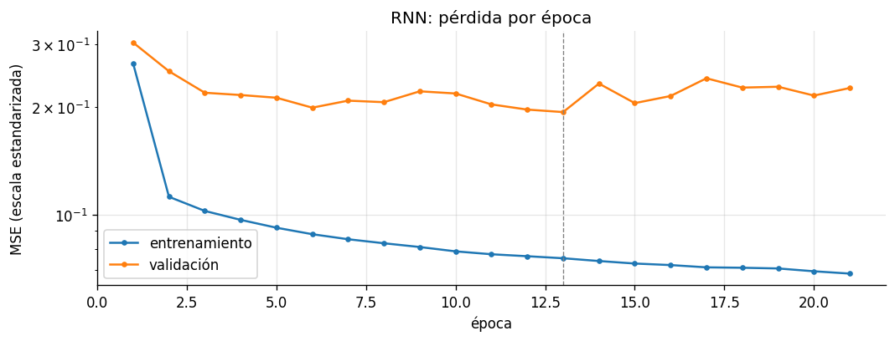
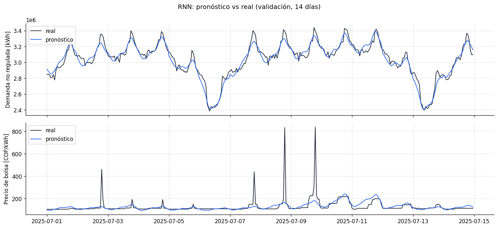
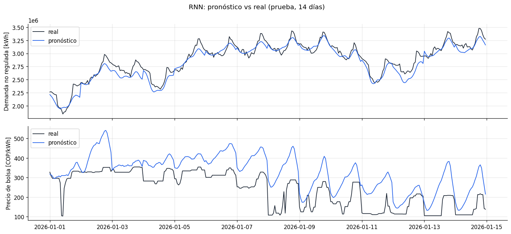
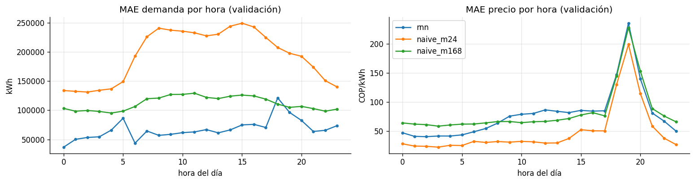
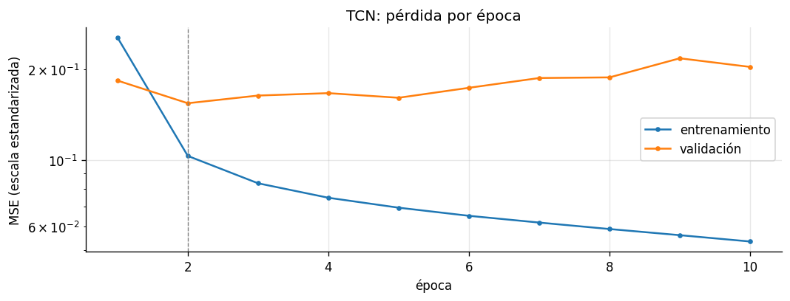
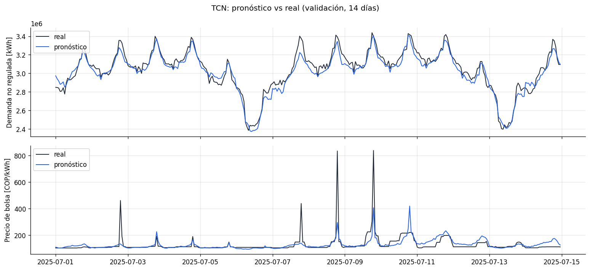
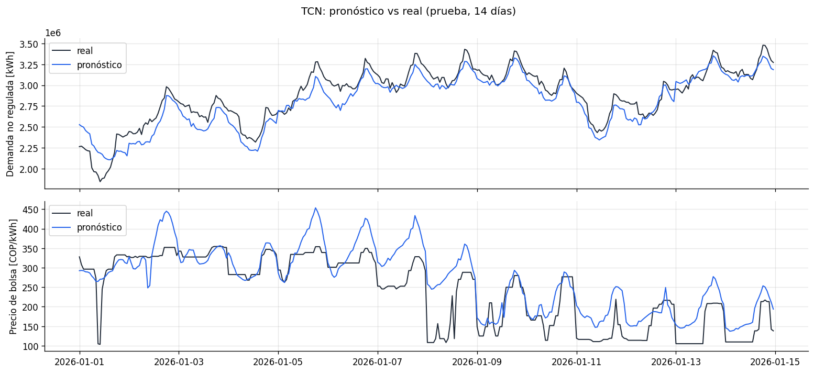
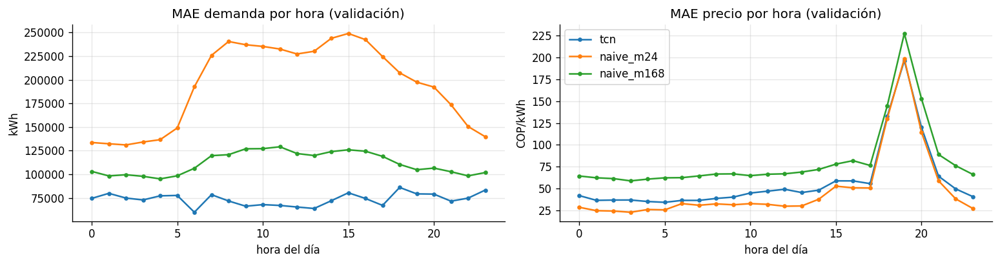

# Resumen

En la fase 2 cada uno de nosotros construye, entrena y evalúa una red neuronal para pronosticar las 24 horas del día siguiente de la demanda no regulada y del precio de bolsa. Al final comparamos las cinco y escogemos las dos que pasan a la fase 3.

| Arquitectura | Responsable | Cuaderno | Estado |
|---|---|---|---|
| RNN simple | Esteban | `01_rnn.ipynb` | **Entrenada** |
| TCN | Sara | `02_tcn.ipynb` | **Entrenada** |
| GRU | Isabel | `03_gru.ipynb` | Por hacer |
| LSTM | Kevin | `04_lstm.ipynb` | Por hacer |
| Transformer | Stiven | `05_transformer.ipynb` | En curso |

La RNN fue la primera, y con ella dejamos montado todo lo que las demás redes comparten: el ciclo de entrenamiento, la evaluación, el guardado de resultados y las figuras. Esta guía explica esas piezas, muestra cómo quedó la RNN y resume lo que cada uno tiene que tener en cuenta para hacer su red. La guía de la fase 1 (`guia_proyecto.html`) sigue siendo la referencia para los datos, el pipeline y las líneas base.

En pocas palabras, la RNN pronostica muy bien la demanda (MAPE de 2,24 % en validación, contra 3,83 % del mejor naive) pero todavía no le gana al naive diario en el precio (37,2 % contra 20,3 %). La TCN es un poco menos precisa en demanda (2,49 %), pero en precio baja el error a 27,4 % y es la primera red que supera al naive diario en RMSE y R² del precio. Los detalles están en las secciones [-@sec-resultados] y [-@sec-resultados-tcn].

# Cómo está organizada la fase 2 {#sec-organizacion}

La idea es que las cinco redes solo se diferencien en la arquitectura. Si cada uno entrenara con su propio ciclo, su propia pérdida o su propia forma de medir el error, al final no sabríamos si una red ganó por ser mejor o por haberse entrenado distinto. Por eso el trabajo quedó en tres capas:

```{mermaid}
flowchart TD
    D["<b>Datos comunes</b><br/>dataset.cargar_datos_modelo()<br/>pasado, futuro, y"] --> C
    A["<b>Arquitectura</b> (una por persona)<br/>modelos/rnn.py, modelos/tcn.py, ...<br/>construir(datos, **hp)"] --> C
    C["<b>Cuaderno</b> (uno por persona)<br/>01_rnn.ipynb, 02_tcn.ipynb, ..."] --> E
    E["<b>Entrenamiento y evaluación comunes</b><br/>entrenamiento.py · metricas.py · visualizacion.py"] --> R
    R["<b>Resultados</b><br/>results/fase2/&lt;nombre&gt;/<br/>reports/figuras/f2_0X_&lt;nombre&gt;_*.png"]
```

1. **Datos comunes.** Todos cargamos los mismos tensores con `cargar_datos_modelo()`, que viene de la fase 1.
2. **Arquitectura.** Lo único que cada uno escribe desde cero: un archivo en `src/energia/modelos/` con la definición de su red.

Así, cuando alguien termina su red, lo que entrega son solo dos archivos: el `.py` de la arquitectura y el cuaderno. El resto ya lo tenemos en el repo.

# Lo que recibe y entrega cada red {#sec-contrato}

## Entradas

`cargar_datos_modelo()` entrega, para cada partición, tres arreglos:

| Tensor | Forma | Contenido |
|---|---|---|
| `pasado` | (lote, 168, 16) | Las últimas 168 horas (una semana) de las 16 variables, escaladas |
| `futuro` | (lote, 24, 9) | El calendario de las 24 horas que se van a pronosticar |
| `y` | (lote, 24, 2) | Demanda y precio reales de esas 24 horas, escalados |

Las 16 variables de `pasado` son:

- Los dos objetivos: `demanda_kwh` y `precio_bolsa_cop_kwh`.
- El precio promedio de contratos (`precio_contrato_cop_kwh`).
- Las cuatro variables hidrológicas con un día de rezago: aportes, media de 7 días de aportes, volumen útil y su cambio en 7 días.
- Las nueve variables de calendario de esas horas pasadas.

Las 9 variables de `futuro` son el calendario de las horas que vienen: seno y coseno de la hora, del día de la semana y del día del año, más `es_festivo`, `es_sabado` y `es_domingo_o_festivo`. Se pueden usar sin problema porque el calendario de mañana se conoce desde hoy.

| Partición | Periodo de los objetivos | Muestras | Para qué se usa |
|---|---|---|---|
| `train` | 2022-01-16 a 2025-06-30 | 30.265 | Ajustar los pesos (una ventana por hora) |
| `val` | 2025-07-01 a 2025-12-31 | 184 | *Early stopping* y comparar las redes |
| `test` | 2026-01-01 a 2026-08-31 | 243 | Solo para reportar al final |

## La regla que tiene que cumplir cada arquitectura

Para que las funciones comunes sirvan con cualquier red, cada archivo `src/energia/modelos/<arquitectura>.py` tiene que tener tres cosas:

1. **Un diccionario `HIPERPARAMETROS`** con los valores por defecto de la red.
2. **Una clase** (que hereda de `nn.Module`) cuyo método `forward(pasado, futuro)` recibe los dos tensores de arriba y devuelve un tensor de forma **(lote, 24, 2)**, en escala estandarizada.
3. **Una función `construir(datos, **hp)`** que lee las dimensiones desde `datos` y devuelve la red construida.

Con eso, el cuaderno y `entrenamiento.py` funcionan igual para todos, sin cambiar una línea.

Cada red pronostica **las dos series a la vez**: una sola red, una sola salida de (24, 2), donde la columna 0 es la demanda y la 1 el precio. No se entrenan dos redes separadas.

# Entrenamiento y evaluación comunes {#sec-entrenamiento}

Todo lo de esta sección está en `src/energia/entrenamiento.py`. Nadie tiene que modificar este archivo para hacer su red.

## Conceptos importantes

Antes de entrar en las funciones, vale la pena dejar claros tres términos que salen todo el tiempo en la salida del entrenamiento:

- **Época:** una pasada completa de la red por los datos de entrenamiento. En cada época la red ve las 30.265 ventanas una vez y ajusta sus pesos.
- **Pérdida (*loss*):** el número que mide qué tan lejos están las predicciones de los valores reales. Entre más bajo, mejor. En cada época se calcula dos veces: sobre entrenamiento (`train`) y sobre validación (`val`).
- **Sobreajuste:** cuando la pérdida de entrenamiento sigue bajando pero la de validación se estanca o sube. La red empezó a memorizar los datos con los que aprende en lugar de capturar patrones que sirvan para días que no ha visto.

## La pérdida

Las redes se entrenan minimizando el error cuadrático medio (MSE) sobre la salida **escalada**, promediando sobre las 24 horas y las dos series:

$$
\mathcal{L}(\mathbf{w}) = \frac{1}{N \cdot 24 \cdot 2} \sum_{i=1}^{N} \sum_{h=1}^{24} \sum_{j=1}^{2} \left( y_{i,h,j} - \hat{y}_{i,h,j}(\mathbf{w}) \right)^2
$$

Se calcula en escala estandarizada a propósito. La demanda está en millones de kWh y el precio en cientos de COP/kWh; si se calculara en unidades originales, la demanda dominaría la pérdida y la red ignoraría el precio. Con las dos series estandarizadas, ambas pesan lo mismo.

Por eso la pérdida no se puede leer como un error en kWh o en pesos. Sirve para comparar épocas o redes entrenadas igual. El error que se reporta es el de la tabla de métricas, en unidades originales.

## `entrenar`

```python
historial = entrenar(modelo, datos, optimizador="adam", lr=1e-3, epocas=50,
                     batch=256, paciencia=8, clip=1.0)
```

En cada época hace lo siguiente:

1. Baraja las ventanas de entrenamiento y las recorre en lotes de 256.
2. Para cada lote calcula la predicción, la pérdida y el gradiente, y actualiza los pesos con el optimizador.
3. Antes de actualizar, recorta el gradiente si su norma pasa de 1 (`clip=1.0`). Esto evita los saltos bruscos en los pesos que aparecen en las redes recurrentes cuando el gradiente explota.
4. Al terminar la época, calcula la pérdida en validación sin actualizar nada.
5. Imprime una línea con las dos pérdidas y el tiempo. Si la validación mejoró, la marca con `*` y guarda una copia de los pesos.

El entrenamiento se detiene por una de dos razones, la que ocurra primero:

- **Parada temprana (*early stopping*):** pasan 8 épocas seguidas (`paciencia=8`) sin que la pérdida de validación baje del mejor valor que lleva. Cualquier mejora reinicia el contador, por pequeña que sea.
- **Límite de épocas:** llega a la época 50.

Al terminar, la red **vuelve a los pesos de la mejor época**. Las épocas que corrió después de esa no la perjudican. La función devuelve el historial (pérdida de entrenamiento, de validación y segundos por época) como una tabla.

El optimizador se escoge por nombre. Están los que vimos en clase: `sgd`, `momentum`, `nesterov`, `adagrad`, `rmsprop`, `adam`, `nadam` y `adamax`. En la fase 2 todos usamos `adam` con `lr=1e-3`; comparar optimizadores es trabajo de la fase 3.

## Las demás funciones

| Función | Qué hace |
|---|---|
| `fijar_semilla()` | Fija las semillas de Python, NumPy y PyTorch (semilla 42) para que al correr dos veces el cuaderno salga lo mismo |
| `dispositivo()` | Devuelve `cuda` si hay una GPU NVIDIA disponible y `cpu` si no |
| `contar_parametros(modelo)` | Número de pesos entrenables de la red |
| `cargador(datos, split, batch)` | Arma el `DataLoader` de PyTorch para una partición |
| `predecir(modelo, datos, split)` | Predice una partición completa y la devuelve **en kWh y COP/kWh**, deshaciendo el escalado y el logaritmo |
| `evaluar_modelo(modelo, datos, split)` | MAE, RMSE, MAPE y R² de cada serie en unidades originales |
| `guardar_modelo(modelo, nombre, hp)` | Guarda `results/modelos/<nombre>.pt` |
| `guardar_resultados(nombre, metricas, hp, historial)` | Guarda `metricas.csv`, `historial.csv` e `hiperparametros.json` en `results/fase2/<nombre>/` |

## Funciones nuevas de visualización

En `src/energia/visualizacion.py` quedaron dos funciones que usan todos los cuadernos, para que las figuras de las cinco redes se vean igual y se puedan poner lado a lado en el informe:

- `curvas_aprendizaje(historial, titulo)`: pérdida de entrenamiento y de validación por época, en escala logarítmica, con una línea punteada en la mejor época.
- `pronostico_vs_real(datos, prediccion, split, dias=14)`: pega 14 pronósticos diarios seguidos y los dibuja contra lo observado, una gráfica para la demanda y otra para el precio.

# La arquitectura RNN {#sec-rnn}

## Cómo funciona una RNN

Una red recurrente lee la secuencia una hora a la vez. En cada paso combina la entrada de esa hora, $\mathbf{x}_t$, con un estado oculto $\mathbf{h}_{t-1}$ que resume todo lo que ha visto antes:

$$
\mathbf{h}_t = \tanh\left( \mathbf{W}_x \mathbf{x}_t + \mathbf{W}_h \mathbf{h}_{t-1} + \mathbf{b} \right)
$$

Los mismos pesos $\mathbf{W}_x$, $\mathbf{W}_h$ y $\mathbf{b}$ se usan en las 168 horas. Al final de la semana, el último estado $\mathbf{h}_{168}$ es un resumen de toda la historia, y a partir de él se construye el pronóstico.

## Planteamiento RNN

```{mermaid}
flowchart TD
    P["pasado<br/>(lote, 168, 16)"] --> R["RNN de 2 capas<br/>64 unidades, tanh"]
    R --> H["último estado oculto<br/>(lote, 64)"]
    F["futuro<br/>(lote, 24, 9)"] --> A["aplanar<br/>(lote, 216)"]
    H --> C["concatenar<br/>(lote, 280)"]
    A --> C
    C --> D["Densa 128 + ReLU + Dropout 0,1"]
    D --> S["Densa 48"]
    S --> Y["reorganizar<br/>(lote, 24, 2)"]
```

1. **Codificador recurrente.** Dos capas `nn.RNN` de 64 unidades con activación tanh leen las 168 horas del pasado. Entre las dos capas hay un *dropout* de 0,1. Nos quedamos con el estado oculto final de la segunda capa: un vector de 64 números que resume la semana.
2. **Calendario de mañana.** El tensor `futuro` (24 horas × 9 variables) se aplana a un vector de 216 y se pega al resumen de la semana. Así la red sabe, por ejemplo, que mañana es domingo o festivo, que es justo donde el naive se equivoca más.
3. **Cabeza densa.** Una capa de 128 neuronas con ReLU y *dropout* de 0,1, y una capa de salida de 48 neuronas (24 horas × 2 series), que se reorganiza en (24, 2).

La red pronostica las 24 horas **de una sola vez** (salida directa). No predice la hora 1, la usa para predecir la 2 y así sucesivamente; con eso evitamos que el error de una hora se arrastre a las siguientes.

| Bloque | Parámetros |
|---|---|
| Capa RNN 1 ($16 \cdot 64 + 64 \cdot 64 + 2 \cdot 64$) | 5.248 |
| Capa RNN 2 ($64 \cdot 64 + 64 \cdot 64 + 2 \cdot 64$) | 8.320 |
| Densa 280 → 128 | 35.968 |
| Densa 128 → 48 | 6.192 |
| **Total** | **55.728** |

Los hiperparámetros por defecto están en `rnn.HIPERPARAMETROS`:

```python
HIPERPARAMETROS = {"oculto": 64, "capas": 2, "dropout": 0.1, "cabeza": 128}
```

## Limitaciones conocidas

- **Gradiente que se desvanece.** Al propagar el error hacia atrás por 168 pasos con tanh, el gradiente se va haciendo cada vez más pequeño y a la red le cuesta aprender relaciones con horas lejanas. Es precisamente el problema que resuelven la LSTM y la GRU con sus compuertas, así que la comparación con ellas va a ser interesante.
- **Procesa la semana en fila.** Para calcular el estado de la hora 100 hay que haber terminado la hora 99, así que las 168 horas no se pueden repartir en paralelo. La TCN sí procesa todas las horas al mismo tiempo, aunque en nuestros computadores, sin GPU, eso no se tradujo en un entrenamiento más corto (sección [-@sec-resultados-tcn]).

# Resultados de la RNN {#sec-resultados}

## Entrenamiento

| | |
|---|---|
| Dispositivo | CPU (PyTorch 2.5.1) |
| Épocas entrenadas | 21 (paró por *early stopping*) |
| Mejor época | 13 |
| Mejor pérdida de validación | 0,1940 |
| Pérdida de entrenamiento en la mejor época | 0,0755 |
| Tiempo total | unos 59 minutos (entre 80 y 400 s por época) |



La validación bajó rápido en las primeras seis épocas, tuvo un bache entre la 7 y la 11, volvió a mejorar en la 12 y la 13, y desde ahí no mejoró más. Mientras tanto, la pérdida de entrenamiento siguió bajando hasta 0,068. Ese es el patrón típico del sobreajuste, y la parada temprana lo cortó a tiempo.

Que la validación quede bastante por encima del entrenamiento (0,19 frente a 0,08) no es raro aquí: el segundo semestre de 2025 tiene el cambio estructural del precio intradía que vimos en la fase 1, así que es el periodo más difícil de los tres.

Los tiempos por época variaron mucho (de 79 a 397 s) según lo que estuviera abierto en el computador al mismo tiempo. Para entrenar conviene cerrar los programas pesados.

## Métricas

| Modelo | Partición | MAE demanda [kWh] | MAPE demanda [%] | R² demanda | MAE precio [COP/kWh] | MAPE precio [%] | R² precio |
|---|---|---|---|---|---|---|---|
| **RNN** | val | **67.180** | **2,24** | **0,87** | 78,8 | 37,21 | 0,32 |
| Naive $m=168$ | val | 111.762 | 3,83 | 0,54 | 81,7 | 37,45 | 0,22 |
| Naive $m=24$ | val | 194.136 | 6,72 | −0,08 | **48,5** | **20,34** | **0,48** |
| **RNN** | test | **82.929** | **2,70** | **0,86** | 127,5 | 29,08 | 0,69 |
| Naive $m=168$ | test | 121.129 | 4,06 | 0,49 | 126,5 | 34,67 | 0,68 |
| Naive $m=24$ | test | 194.817 | 6,67 | 0,07 | **56,1** | **14,86** | **0,88** |

Frente a la meta que nos pusimos en la fase 1 (MAPE de demanda menor a 3,83 % y de precio menor a 20,34 % en validación):

- **Demanda: cumple.** El MAPE baja de 3,83 % a 2,24 % en validación (41 % menos error) y de 4,06 % a 2,70 % en prueba (33 % menos). El R² pasa de 0,54 a 0,87.
- **Precio: no cumple.** Queda prácticamente igual que el naive semanal y bastante peor que el naive diario, que sigue siendo la mejor referencia para el precio.

## Pronóstico contra lo observado





En la **demanda**, la red sigue muy de cerca el ciclo diario y anticipa bien las caídas de los domingos (6 y 13 de julio de 2025). En prueba arranca con el bajón de comienzo de año y luego se recupera con la demanda.

En el **precio** se ven dos problemas:

- **Suaviza demasiado.** Pronostica una curva redondeada y no alcanza los picos de 400 a 800 COP/kWh de julio, ni los escalones con que el precio cambia de nivel.
- **No se adapta a los cambios de nivel.** En enero de 2026 el precio real cae hasta 100–300 COP/kWh y la red sigue pronosticando entre 300 y 500. Le cuesta reaccionar cuando el precio baja de golpe, y eso es justo lo que el naive diario capta sin esfuerzo, porque copia el día anterior.

## Error por hora del día



- En **demanda**, la RNN tiene menos error que los dos naive en casi todas las horas. La única excepción es un salto a las 18:00, cuando la demanda empieza a caer al final de la jornada, donde queda parecida al naive semanal.
- En **precio**, la RNN va por encima del naive diario en todas las horas. Los tres modelos tienen el pico de error a las 19:00, la hora de los picos de precio y del cambio estructural.

## Conclusión RNN

La RNN aprende bien la demanda, que es una serie regular, con ciclos claros y muy marcada por el calendario. El precio es otra historia: se mueve por saltos y cambios de régimen, y copiar el día anterior resulta difícil de superar. Esto pasa mucho en mercados eléctricos y es un resultado que vale la pena discutir en el informe.

Es importante recordar que esta RNN tiene los hiperparámetros por defecto y no se afinó. No la vamos a ajustar en esta fase: primero vemos cómo les va a las otras cuatro. Para el precio, la LSTM y la GRU podrían ayudar porque recuerdan mejor lo que pasó hace muchas horas.

# La arquitectura TCN {#sec-tcn}

## Cómo funciona una TCN

Una red convolucional temporal (TCN) lee la semana con filtros que se deslizan sobre el tiempo, en lugar de recorrerla hora por hora como la RNN. Tiene dos ingredientes:

- **Convoluciones causales.** El filtro que calcula la salida de la hora $t$ solo mira la hora $t$ y las anteriores, nunca las siguientes. Así la red no puede usar información del futuro.
- **Dilataciones.** En cada nivel el filtro salta más horas: en el primero mira horas seguidas, en el segundo cada 2 horas, luego cada 4, y así. Con pocas capas, cada salida termina viendo cientos de horas hacia atrás.

Con un filtro de tamaño $k$, dos convoluciones por bloque y dilataciones $d_1, \dots, d_L$, el campo receptivo, es decir, cuántas horas hacia atrás alcanza a ver cada salida, es:

$$
R = 1 + 2\,(k-1)\sum_{i=1}^{L} d_i
$$

Con $k = 3$ y dilataciones 1, 2, 4, 8, 16 y 32, queda $R = 1 + 4 \cdot 63 = 253$ horas, más que las 168 de la ventana. La última salida ve la semana completa.

## Versiones evaluadas

Antes de fijar la arquitectura se evaluaron cuatro formas de pasar de lo que la TCN aprende de la semana al pronóstico de mañana. La parte convolucional fue la misma en las cuatro; lo que cambió fue la salida. Estas pruebas se hicieron con un ciclo de entrenamiento preliminar (40 épocas y paciencia de 6), así que los valores sirven para comparar las versiones entre sí y no con las demás redes.

| Versión | Qué usa para pronosticar cada hora de mañana | MAPE precio val (aprox.) |
|---|---|---|
| v1 | Un solo resumen de toda la semana: la salida de la TCN en la última hora, repetida para las 24 | 36 % |
| v2 | La salida de la TCN en la misma hora de ayer | 30 % |
| v3 | Lo de la v2 más los valores reales de la misma hora de ayer | 28 % |
| v4 | El naive (misma hora de la semana pasada para la demanda y de ayer para el precio) más una corrección aprendida por la red | 26 % |

La v1 hace lo mismo que nuestra RNN, resumir la semana en un solo vector, y su error de precio quedó casi igual al de la RNN (37 %). El salto grande vino en la v2, cuando cada hora de mañana pasó a mirar la misma hora de ayer: es la misma lógica del naive diario, pero aprendida por la red. Ahí está buena parte de la explicación de por qué a la RNN le va mal en el precio.

Se escogió la **v3**, que tuvo la menor pérdida de validación. La v4 dio los mejores MAPE, pero incorpora la línea base dentro del modelo, por lo que se dejó como experimento aparte. La v3 es la que quedó en `modelos/tcn.py` y la que se entrenó con la configuración común.

## Planteamiento TCN

```{mermaid}
flowchart TD
    P["pasado<br/>(lote, 168, 16)"] --> T["6 bloques residuales<br/>convoluciones causales<br/>dilataciones 1 a 32 · 32 canales"]
    T --> U["salida de las últimas 24 horas<br/>(lote, 24, 32)"]
    P --> A["valores reales de las últimas 24 horas<br/>(lote, 24, 16)"]
    F["futuro<br/>(lote, 24, 9)"] --> C
    U --> C["concatenar por hora<br/>(lote, 24, 57)"]
    A --> C
    C --> D["Densa 64 + ReLU + Dropout 0,1<br/>(la misma para las 24 horas)"]
    D --> S["Densa 2<br/>(lote, 24, 2)"]
```

1. **Codificador convolucional.** Seis bloques residuales. Cada bloque tiene dos convoluciones causales de 32 canales, con ReLU y *dropout* de 0,1, y un atajo que suma la entrada a la salida para que la red profunda entrene bien. La dilatación se duplica en cada bloque: 1, 2, 4, 8, 16 y 32.
2. **Correspondencia con ayer.** De la salida de la TCN se toman las últimas 24 horas. La hora $h$ de mañana queda emparejada con la hora $h$ de ayer.
3. **Valores reales de ayer.** A cada hora se le pegan también los 16 valores originales de esa misma hora de ayer, sin pasar por las convoluciones, para que la red no pierda el dato exacto del precio y la demanda.
4. **Calendario de mañana.** Se agregan las 9 variables de calendario de cada hora a pronosticar.
5. **Cabeza densa compartida.** Una misma red de 64 neuronas procesa cada una de las 24 horas y entrega sus 2 salidas.

| Bloque | Parámetros |
|---|---|
| Bloque 1 (16 → 32 canales, con atajo de 1 × 1) | 5.216 |
| Bloques 2 a 6 (32 → 32 canales, 6.208 cada uno) | 31.040 |
| Densa 57 → 64 | 3.712 |
| Densa 64 → 2 | 130 |
| **Total** | **40.098** |

Los hiperparámetros por defecto están en `tcn.HIPERPARAMETROS`:

```python
HIPERPARAMETROS = {"canales": 32, "kernel": 3, "niveles": 6, "dropout": 0.1, "cabeza": 64}
```

Tiene menos parámetros que la RNN (40.098 frente a 55.728), porque la cabeza se comparte entre las 24 horas en lugar de tener una salida distinta para cada una.

# Resultados de la TCN {#sec-resultados-tcn}

## Entrenamiento

| | |
|---|---|
| Dispositivo | CPU (PyTorch 2.5.1) |
| Épocas entrenadas | 10 (paró por *early stopping*) |
| Mejor época | 2 |
| Mejor pérdida de validación | 0,1545 |
| Pérdida de entrenamiento en la mejor época | 0,1031 |
| Tiempo total | unos 43 minutos (entre 200 y 315 s por época) |



La TCN alcanzó su mejor validación muy temprano, en la segunda época, con 0,1545, bastante por debajo del 0,1940 de la RNN. Desde la tercera época el entrenamiento siguió bajando hasta 0,054 mientras la validación subía hasta 0,22: sobreajusta rápido. Es un dato útil para la fase 3, porque sugiere probar más *dropout* o una tasa de aprendizaje más baja.

En la primera época la validación quedó por debajo del entrenamiento. Pasa porque la pérdida de entrenamiento es el promedio de toda la época, incluidos los primeros lotes en los que la red todavía no sabía nada, y además se calcula con *dropout* activo.

Cada época tardó más que en la RNN. En teoría la TCN es más paralelizable, pero en CPU las convoluciones sobre 168 horas con 32 canales también son costosas, y aquí no hubo GPU para aprovechar ese paralelismo. Al final tardó menos en total porque necesitó menos épocas.

## Métricas

| Modelo | Partición | MAE demanda [kWh] | MAPE demanda [%] | R² demanda | MAE precio [COP/kWh] | MAPE precio [%] | RMSE precio [COP/kWh] | R² precio |
|---|---|---|---|---|---|---|---|---|
| **TCN** | val | **73.563** | **2,49** | **0,86** | 57,7 | 27,43 | **102,1** | **0,56** |
| Naive $m=168$ | val | 111.762 | 3,83 | 0,54 | 81,7 | 37,45 | 136,1 | 0,22 |
| Naive $m=24$ | val | 194.136 | 6,72 | −0,08 | **48,5** | **20,34** | 111,8 | 0,48 |
| **TCN** | test | **83.670** | **2,74** | **0,86** | 83,1 | 20,68 | 123,3 | 0,85 |
| Naive $m=168$ | test | 121.129 | 4,06 | 0,49 | 126,5 | 34,67 | 182,2 | 0,68 |
| Naive $m=24$ | test | 194.817 | 6,67 | 0,07 | **56,1** | **14,86** | **111,1** | **0,88** |

- **Demanda: cumple.** El MAPE baja de 3,83 % a 2,49 % en validación y de 4,06 % a 2,74 % en prueba. Queda un poco por detrás de la RNN (2,24 % y 2,70 %).
- **Precio: no cumple la meta en MAPE, pero mejora mucho frente a la RNN.** En validación pasa de 37,2 % (RNN) a 27,4 %, y en prueba de 29,1 % a 20,7 %. Todavía no le gana al naive diario en MAPE ni en MAE.
- **En RMSE y R² del precio sí le gana al naive diario en validación** (102,1 frente a 111,8, y 0,56 frente a 0,48). Como el RMSE castiga más los errores grandes, esto dice que la TCN se equivoca menos que el naive cuando hay picos, aunque en los días normales todavía se aleja un poco más del valor real.

## Pronóstico contra lo observado





En la **demanda**, el comportamiento es muy parecido al de la RNN: sigue bien el ciclo diario y las caídas de los domingos, aunque en algunos días laborales se queda un poco corta en los máximos.

En el **precio** se nota la diferencia con la RNN:

- **Reacciona a los picos.** En validación ya no pronostica una línea plana: en varios de los picos de julio sube a 300–420 COP/kWh, aunque no alcanza los 800 reales.
- **Sigue la forma del día.** Los escalones del precio aparecen en el pronóstico con la forma correcta, porque cada hora mira la misma hora de ayer.
- **Todavía sobreestima cuando el precio cae de golpe.** En enero de 2026, cuando el precio baja a 100–250 COP/kWh, la TCN se queda por encima, aunque menos que la RNN.

## Error por hora del día



- En **demanda**, la TCN tiene menos error que los dos naive en todas las horas.
- En **precio**, la TCN queda entre los dos naive: siempre por debajo del semanal y cerca del diario. En las horas de la tarde y la noche (17:00 a 21:00), donde están los picos, prácticamente lo iguala.

## Conclusión TCN

La TCN confirma lo que habían sugerido las versiones evaluadas: lo que más ayuda con el precio no es el tipo de capa, sino conectar cada hora de mañana con la misma hora de ayer. Con eso, la TCN pronostica la demanda casi tan bien como la RNN y el precio bastante mejor, y es la primera red que le gana al naive diario en alguna métrica del precio (RMSE y R² en validación).

También sobreajusta muy rápido: la mejor época fue la segunda. Si la TCN pasa a la fase 3, lo primero sería regularizarla más.

# Regla a tener en cuenta para que los modelos sean comparables {#sec-reglas}

1. **Los datos se cargan con `cargar_datos_modelo()`** y no se cambian la ventana, el horizonte, las particiones ni el escalado.
2. **Se entrena y se predice con las funciones de `energia.entrenamiento`**: `entrenar`, `predecir` y `guardar_resultados`. Nada de ciclos de entrenamiento propios.
3. **`HP_ENTRENAMIENTO` se deja igual que en la RNN**: Adam, `lr=1e-3`, 50 épocas, lote de 256, paciencia de 8 y recorte de gradiente en 1. Lo que cada uno ajusta es `HP_MODELO`, es decir, el tamaño y la forma de su red. Si una red de verdad no aprende con esta configuración, se puede bajar el `lr`, y el cambio queda registrado en `hiperparametros.json`.
4. **No se modifican los archivos comunes** (`config.py`, `dataset.py`, `metricas.py`, `entrenamiento.py`, `visualizacion.py`).
5. **Las decisiones se toman con validación.** La prueba se reporta, pero no se mira para escoger hiperparámetros.

# Cuadro Comparativo Final

Cuando estén las cinco redes, juntamos los `metricas.csv` de `results/fase2/` y los comparamos. Las redes se escogen con la validación; la prueba se mira al final para confirmar que el resultado se sostiene con datos de 2026.

## Validación (julio a diciembre de 2025)

| Red | MAE demanda [kWh] | MAPE demanda [%] | R² demanda | MAE precio [COP/kWh] | MAPE precio [%] | R² precio |
|---|---|---|---|---|---|---|
| RNN | 67.180 | 2,24 | 0,87 | 78,8 | 37,21 | 0,32 |
| TCN | 73.563 | 2,49 | 0,86 | 57,7 | 27,43 | 0,56 |
| GRU | | | | | | |
| LSTM | | | | | | |
| Transformer | | | | | | |
| *Naive $m=168$* | *111.762* | *3,83* | *0,54* | *81,7* | *37,45* | *0,22* |
| *Naive $m=24$* | *194.136* | *6,72* | *−0,08* | *48,5* | *20,34* | *0,48* |

## Prueba (enero a agosto de 2026)

| Red | MAE demanda [kWh] | MAPE demanda [%] | R² demanda | MAE precio [COP/kWh] | MAPE precio [%] | R² precio |
|---|---|---|---|---|---|---|
| RNN | 82.929 | 2,70 | 0,86 | 127,5 | 29,08 | 0,69 |
| TCN | 83.670 | 2,74 | 0,86 | 83,1 | 20,68 | 0,85 |
| GRU | | | | | | |
| LSTM | | | | | | |
| Transformer | | | | | | |
| *Naive $m=168$* | *121.129* | *4,06* | *0,49* | *126,5* | *34,67* | *0,68* |
| *Naive $m=24$* | *194.817* | *6,67* | *0,07* | *56,1* | *14,86* | *0,88* |

## Entrenamiento

| Red | Mejor época | Épocas entrenadas | Parámetros | Tiempo |
|---|---|---|---|---|
| RNN | 13 | 21 | 55.728 | ~59 min (CPU) |
| TCN | 2 | 10 | 40.098 | ~43 min (CPU) |
| GRU | | | | |
| LSTM | | | | |
| Transformer | | | | |

Con estas tablas, las curvas de aprendizaje y las figuras de pronóstico escogemos las dos redes que pasan a la fase 3, siguiendo el criterio de la sección [-@sec-criterio].

# Criterio de selección para la fase 3 {#sec-criterio}

El criterio se fija antes de tener los resultados de las cinco redes, para que la elección no dependa de cuál termina gustándonos más. Se aplica en este orden:

1. **Requisito mínimo: superar la línea base de demanda.** La red debe tener un MAPE de demanda en validación menor a 3,83 %, el del naive semanal. Una red que no cumpla esto no pasa, sin importar cómo le vaya en el precio.
2. **Criterio principal: MAPE de precio en validación.** Entre las redes que cumplen el requisito, pasan las dos con menor MAPE de precio. Es la serie donde las redes más se diferencian: en demanda todas quedan muy cerca entre sí, mientras que en el precio las diferencias son de varios puntos.
3. **Desempate: MAPE de demanda en validación.** Si dos redes quedan a menos de 1 punto de diferencia en el MAPE de precio, se considera empate y pasa la de menor MAPE de demanda.
4. **La prueba no se usa para escoger.** Las métricas de prueba se reportan para confirmar que la elección se sostiene con datos de 2026, pero no cambian el resultado. Si una red escogida se comporta mucho peor en prueba que en validación, se reporta y se discute, pero no se reemplaza.

Como información complementaria, y no como criterio, se reportan también el RMSE y el R² del precio, que muestran qué tan bien maneja cada red los picos, y el tiempo de entrenamiento, que pesa en la fase 3 porque ahí cada red se va a entrenar muchas veces.

# Referencias

- Goodfellow, I., Bengio, Y. y Courville, A. (2016). *Deep Learning*, capítulo 10: Sequence Modeling: Recurrent and Recursive Nets. MIT Press. <https://www.deeplearningbook.org/>
- Bai, S., Kolter, J. Z. y Koltun, V. (2018). *An Empirical Evaluation of Generic Convolutional and Recurrent Networks for Sequence Modeling*. arXiv:1803.01271.
- Hochreiter, S. y Schmidhuber, J. (1997). Long Short-Term Memory. *Neural Computation*, 9(8), 1735–1780.
- Cho, K. et al. (2014). *Learning Phrase Representations using RNN Encoder–Decoder for Statistical Machine Translation*. arXiv:1406.1078.
- Vaswani, A. et al. (2017). *Attention Is All You Need*. arXiv:1706.03762.
- Hyndman, R. J. y Athanasopoulos, G. (2021). *Forecasting: Principles and Practice* (3.ª ed.). OTexts. <https://otexts.com/fpp3/>
- PyTorch. Documentación de `torch.nn`. <https://pytorch.org/docs/stable/nn.html>
- Torres, M. C. (2026). *Optimización e Inteligencia Artificial*, notas de clase. Universidad Nacional de Colombia.
