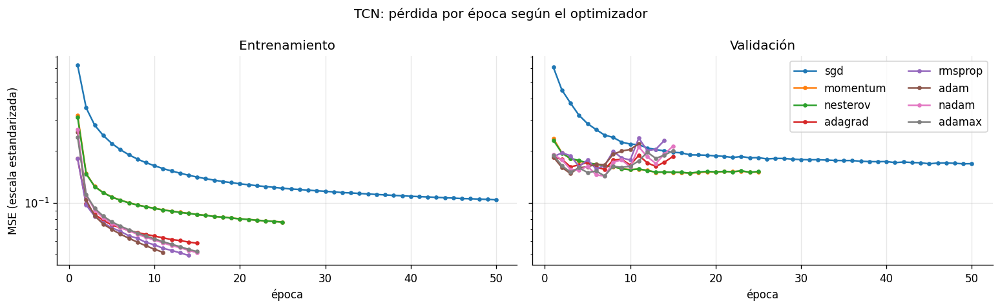
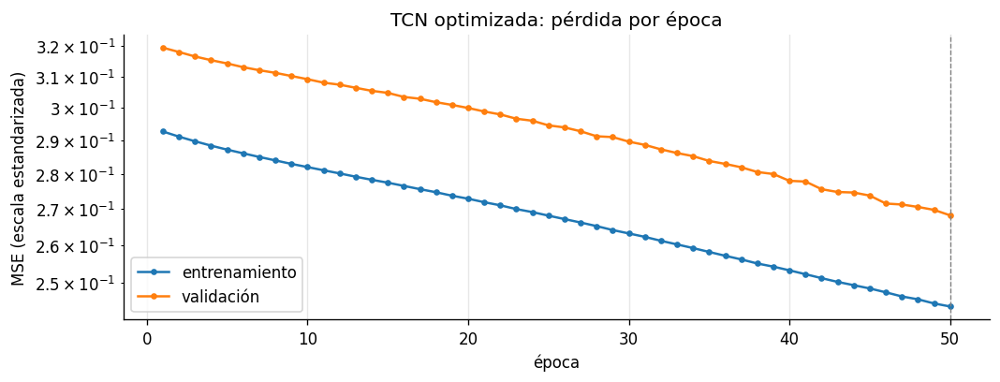
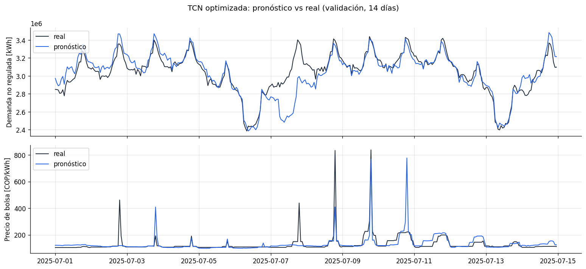
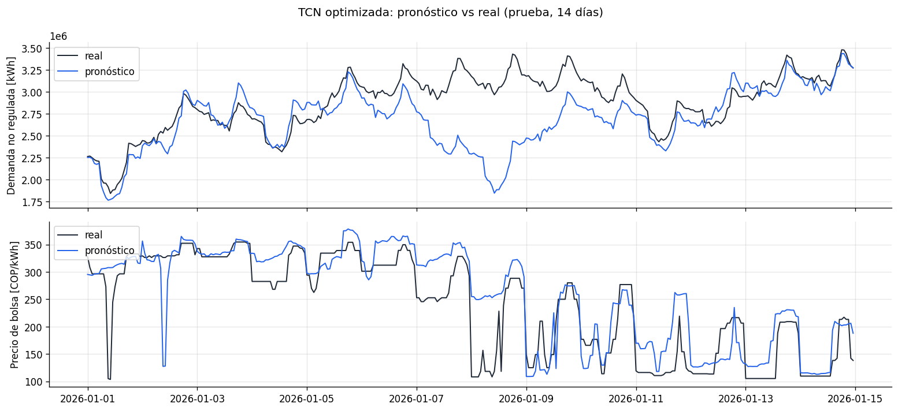
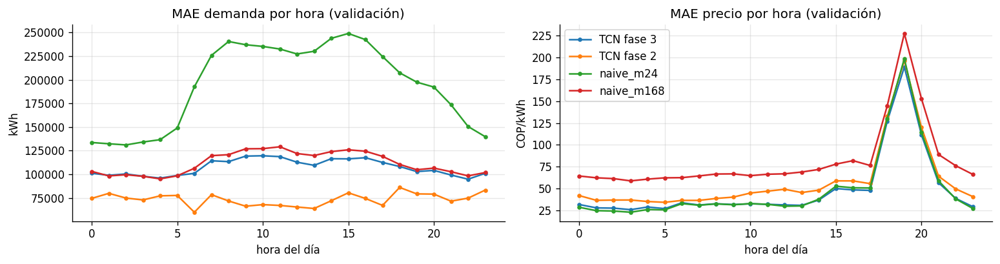
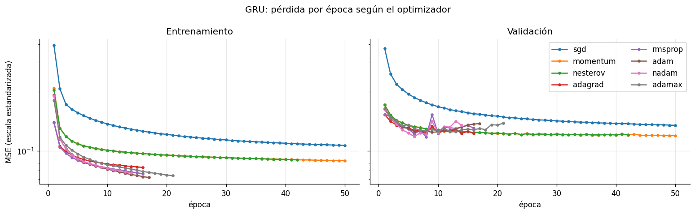
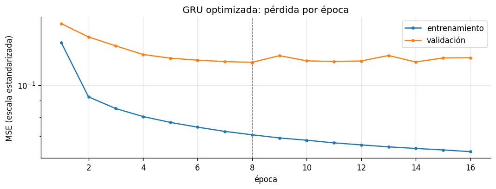
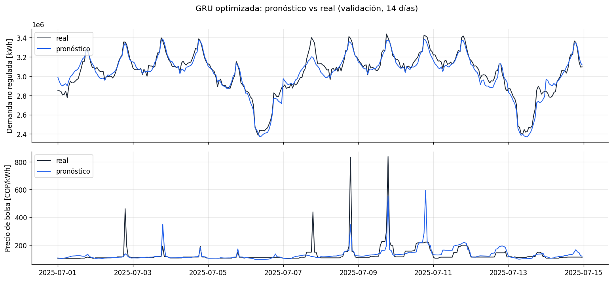
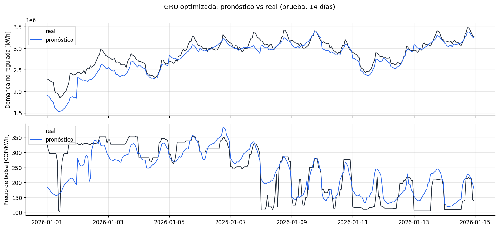
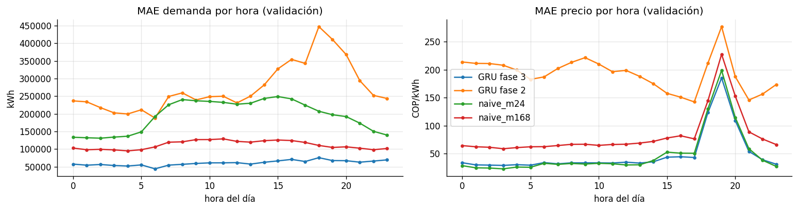

# Resumen

En la fase 2 entrenamos cinco redes con la misma configuración y, con el criterio de selección acordado, pasaron a esta fase la **GRU** (23,55 % de MAPE de precio en validación) y la **TCN** (27,43 %). En la fase 3 tomamos esas dos redes y buscamos la mejor forma de entrenarlas: qué optimizador usar, con qué tasa de aprendizaje, cuánta regularización, si conviene hacerlas más grandes y si les sirve partir del pronóstico naive.

| Red | Responsable | Cuaderno | Estado |
|---|---|---|---|
| TCN | Esteban | `01_tcn_optimizacion.ipynb` | **Optimizada** |
| GRU | Isabel | `02_gru_optimizacion.ipynb` | **Optimizada** |

Cada red pasó por 24 entrenamientos organizados en cuatro etapas. Los resultados, en pocas palabras:

- **La GRU mejoró en todo.** En validación, el MAPE de precio bajó de 23,55 % a 20,90 % y el de demanda de 2,41 % a 2,04 %. También mejoraron el RMSE y el R² del precio. En MAPE de precio queda prácticamente empatada con el naive diario (20,34 %) y lo supera en RMSE (96,7 contra 111,8) y R² (0,61 contra 0,48).
- **La TCN cambió demanda por precio.** El MAPE de precio bajó de 27,43 % a 20,95 %, pero la demanda subió de 2,49 % a 3,62 %, y el RMSE y el R² del precio quedaron peor que en la fase 2. La configuración ganadora quedó muy cerca de los dos naive.
- **El modelo final del proyecto es la GRU optimizada.** Las dos redes quedan empatadas en MAPE de precio (20,90 % y 20,95 %), y con el desempate por demanda gana la GRU con amplia diferencia (2,04 % contra 3,62 %).

Los detalles de cada red están en las secciones [-@sec-tcn] y [-@sec-gru], y la comparación final en la sección [-@sec-comparacion].

# Optimización {#sec-alcance}

Para que las comparaciones dentro de la fase sean justas, hay cosas que no se tocan:

- **Los datos.** Se cargan con `cargar_datos_modelo()`, con la misma ventana de 168 horas, el mismo horizonte de 24 y las mismas particiones de la fase 1.
- **La pérdida y el ciclo de entrenamiento.** MSE en escala estandarizada y la misma función `entrenar` de la fase 2, con lotes de 256, paciencia de 8 épocas, recorte del gradiente en 1 y un máximo de 50 épocas (salvo en una variante, que se explica más adelante).
- **La forma de evaluar.** Las métricas se calculan con `evaluar` en unidades originales, y las decisiones se toman con validación. La prueba solo se mira en la última etapa.

Lo que sí se mueve en esta fase:

| Grupo | Qué se prueba |
|---|---|
| Optimizador | Los ocho vistos en clase: SGD, momentum, Nesterov, Adagrad, RMSprop, Adam, Nadam y Adamax |
| Tasa de aprendizaje | La inicial de cada optimizador y su tercera parte |
| Regularización | *Dropout* y *weight decay* |
| Tamaño de la red | Más unidades en el codificador o en la cabeza densa |
| Corrección del naive | Que la red parta del pronóstico naive y aprenda solo la corrección |
| Semilla | Tres semillas para la configuración final |

# Planteamiento {#sec-organizacion}

```{mermaid}
flowchart TD
    D["<b>Datos comunes</b><br/>cargar_datos_modelo()"] --> C
    A["<b>Arquitecturas de la fase 2</b><br/>modelos/tcn.py · modelos/gru.py"] --> C
    C["<b>Cuaderno</b> (uno por red)<br/>01_tcn_optimizacion.ipynb<br/>02_gru_optimizacion.ipynb"] --> O
    O["<b>optimizacion.py</b><br/>experimento · etapa · mejor"] --> E
    E["<b>Entrenamiento y evaluación comunes</b><br/>entrenamiento.py · metricas.py"] --> R
    R["<b>Resultados</b><br/>results/fase3/&lt;red&gt;/experimentos.csv<br/>results/fase3/&lt;red&gt;/historiales/<br/>reports/figuras/f3_0X_&lt;red&gt;_*.png"]
```

Todo lo nuevo de esta fase está en `src/energia/optimizacion.py`. Cada entrenamiento de la búsqueda se llama un **experimento** y queda guardado como una fila en `results/fase3/<red>/experimentos.csv`, con sus hiperparámetros, la mejor época, el tiempo y todas las métricas de validación (y de prueba, cuando se piden).

| Función | Qué hace |
|---|---|
| `experimento(red, etapa, nombre, ...)` | Entrena una configuración, la evalúa y la agrega al registro. Si ya estaba registrada, no la vuelve a entrenar y devuelve el resultado guardado |
| `etapa(red, nombre_etapa)` | Tabla de una etapa ordenada por MAPE de precio en validación |
| `mejor(red, etapas)` | Escoge la mejor configuración de una o varias etapas con el criterio de selección |
| `historial(red, etapa, nombre, semilla)` | Pérdida por época de un experimento |
| `cargar_modelo(red, etapa, nombre, ...)` | Carga los pesos de un modelo de la etapa final |

Que el registro se lea antes de entrenar tiene una ventaja práctica: si el cuaderno se interrumpe, o si se agrega una configuración nueva, basta con volver a correrlo completo. Lo que ya está registrado pasa en segundos y solo se entrena lo que falta.

Las dos búsquedas se corrieron en una GPU NVIDIA con CUDA 12.4 (PyTorch 2.5.1). Cada configuración tardó entre medio minuto y 7 minutos, y cada red completa tomó menos de una hora.

# Conceptos importantes {#sec-conceptos}

## Los ocho optimizadores

Todos actualizan los pesos $\mathbf{w}$ a partir del gradiente de la pérdida en el lote, $\mathbf{g}_t = \nabla \mathcal{L}(\mathbf{w}_t)$, con una tasa de aprendizaje $\eta$. Lo que cambia es cómo usan ese gradiente.

| Optimizador | Actualización | Idea |
|---|---|---|
| SGD | $\mathbf{w}_{t+1} = \mathbf{w}_t - \eta\,\mathbf{g}_t$ | Da un paso en contra del gradiente del lote |
| Momentum | $\mathbf{v}_{t+1} = \beta\,\mathbf{v}_t + \mathbf{g}_t$, $\;\mathbf{w}_{t+1} = \mathbf{w}_t - \eta\,\mathbf{v}_{t+1}$ | Acumula la dirección de los pasos anteriores ($\beta = 0{,}9$) y avanza más rápido en las direcciones que se repiten |
| Nesterov | Como momentum, pero el gradiente se evalúa en el punto al que llevaría la velocidad | Corrige antes de pasarse |
| Adagrad | $\mathbf{w}_{t+1} = \mathbf{w}_t - \dfrac{\eta}{\sqrt{\mathbf{G}_t} + \epsilon}\,\mathbf{g}_t$, con $\mathbf{G}_t = \sum_{s \le t} \mathbf{g}_s^2$ | Cada peso tiene su propio paso, que se achica a medida que acumula gradientes |
| RMSprop | Igual que Adagrad, pero $\mathbf{G}_t$ es un promedio móvil de $\mathbf{g}_t^2$ | El paso no se apaga con el tiempo |
| Adam | Promedio móvil del gradiente ($\mathbf{m}_t$) dividido por la raíz del promedio móvil de $\mathbf{g}_t^2$ ($\mathbf{v}_t$) | Junta momentum y RMSprop |
| Nadam | Adam con el momentum de Nesterov | Adam que corrige antes de pasarse |
| Adamax | Adam con el máximo de $|\mathbf{g}_t|$ en lugar de la raíz de $\mathbf{v}_t$ | Pasos más estables cuando hay gradientes muy grandes |

Los tres primeros usan el mismo paso para todos los pesos y por eso se llaman de tasa fija. Los otros cinco ajustan el paso de cada peso según su historia y se llaman adaptativos. En la práctica, los adaptativos bajan la pérdida mucho más rápido en las primeras épocas, pero también suelen sobreajustar antes.

## Tasa de aprendizaje

Es el tamaño del paso. Si es muy grande, la pérdida oscila o diverge; si es muy pequeña, el entrenamiento avanza tan despacio que llega a las 50 épocas sin terminar de aprender. Cada optimizador tiene un rango razonable distinto: SGD necesita pasos más grandes que Adam, porque Adam ya escala el gradiente por su cuenta.

## Regularización

- ***Dropout*.** Durante el entrenamiento apaga al azar una fracción de las neuronas en cada lote. La red no puede depender de unas pocas conexiones y tiene que repartir lo que aprende. En validación y prueba no se apaga nada.
- ***Weight decay*.** Le suma a la pérdida un castigo proporcional al tamaño de los pesos, $\lambda \lVert \mathbf{w} \rVert^2$, para que la red prefiera soluciones con pesos pequeños.

Las dos sirven contra el sobreajuste, que en la fase 2 fue el problema común: la TCN tuvo su mejor época en la segunda y la GRU en la séptima.

## Corrección del naive

Las dos redes tienen la opción `corregir_naive`. Cuando está activa, la salida de la red se suma al pronóstico naive de cada serie: la demanda de la misma hora de la semana pasada y el precio de la misma hora de ayer.

$$
\hat{y}_{h} = \underbrace{y^{\text{naive}}_{h}}_{\text{punto de partida}} + \underbrace{f(\text{pasado}, \text{futuro})_{h}}_{\text{lo que aprende la red}}
$$

Además, la última capa empieza con pesos en cero, así que antes de entrenar la red devuelve exactamente el naive. Lo que aprende es cuánto corregirlo. En la fase 2 la opción estuvo apagada en todas las redes, para que ninguna se apoyara en la línea base; en esta fase se prueba como una variante más.

## Semillas

La semilla fija el azar del entrenamiento: los pesos iniciales, el orden de los lotes y las neuronas que apaga el *dropout*. Con otra semilla, la misma configuración da un resultado algo distinto. Por eso la configuración final se entrena con tres semillas (42, 7 y 2026) y se reporta el promedio y la desviación estándar.

# Diseño de la búsqueda {#sec-diseno}

Probar todas las combinaciones de optimizador, tasa de aprendizaje, *dropout*, *weight decay* y tamaño habría significado cientos de entrenamientos por red. En lugar de eso, la búsqueda se hizo por etapas: cada una parte de lo mejor de la anterior.

| Etapa | Qué se prueba | Configuraciones |
|---|---|---|
| 1. Optimizador | Los 8 optimizadores con la red de la fase 2, cada uno con su tasa inicial | 8 |
| 2. Regularización | Con el mejor optimizador: tasa inicial y su tercera parte × dos valores de *dropout* × *weight decay* 0 y 1e-4 | 8 |
| 3. Arquitectura | Sobre la mejor configuración: red más ancha, cabeza más grande y tres variantes con corrección del naive | 5 |
| 4. Final | La mejor configuración de las etapas 2 y 3 con tres semillas, evaluada también en prueba | 3 |

Las tasas iniciales de la etapa 1 fueron:

| SGD | Momentum | Nesterov | Adagrad | RMSprop | Adam | Nadam | Adamax |
|---|---|---|---|---|---|---|---|
| 1e-2 | 1e-2 | 1e-2 | 1e-2 | 1e-3 | 1e-3 | 1e-3 | 2e-3 |

Para escoger en cada etapa se usa el mismo criterio de la fase 2: entre las configuraciones con MAPE de demanda en validación menor a 3,83 % (el del naive semanal), gana la de menor MAPE de precio en validación. La prueba no se usa en ninguna decisión.

# Resultados de la TCN {#sec-tcn}

La TCN de la fase 2 tenía 32 canales, kernel 3, 6 niveles, *dropout* de 0,1 y cabeza de 64 neuronas, y se entrenó con Adam a `lr=1e-3`. Ese es el punto de partida.

## Etapa 1: optimizador

| Optimizador | MAPE precio [%] | MAPE demanda [%] | RMSE precio | R² precio | Pérdida val | Mejor época | Épocas |
|---|---|---|---|---|---|---|---|
| **SGD** | **25,32** | 2,82 | 100,1 | 0,58 | 0,168 | 45 | 50 |
| Nesterov | 26,52 | 2,41 | 100,4 | 0,58 | 0,148 | 17 | 25 |
| Momentum | 26,52 | 2,41 | 100,3 | 0,58 | 0,149 | 17 | 25 |
| Adamax | 26,79 | 2,21 | 101,1 | 0,57 | 0,143 | 7 | 15 |
| Adam | 27,28 | 2,32 | 102,2 | 0,56 | 0,148 | 3 | 11 |
| Nadam | 27,91 | 2,13 | 101,4 | 0,57 | 0,142 | 7 | 15 |
| Adagrad | 29,88 | 2,26 | 105,0 | 0,54 | 0,156 | 7 | 15 |
| RMSprop | 30,23 | 2,16 | 103,6 | 0,55 | 0,157 | 6 | 14 |



La figura muestra dos comportamientos muy distintos:

- **Los adaptativos** (Adagrad, RMSprop, Adam, Nadam y Adamax) bajan la pérdida de entrenamiento muy rápido y llegan a su mejor validación entre la tercera y la séptima época. Desde ahí la validación oscila y sube, y la parada temprana los corta antes de la época 15.
- **Los de tasa fija** avanzan más despacio y sin saltos. Momentum y Nesterov dan prácticamente el mismo resultado y llegan a su mejor época en la 17. SGD sin momentum es el más lento: a las 50 épocas su validación todavía estaba bajando.

Hay algo que vale la pena notar: la menor pérdida de validación la tienen Nadam y Adamax (0,142 y 0,143), pero el menor MAPE de precio lo tiene SGD, que tiene la pérdida más alta de los tres primeros. La pérdida mide el error cuadrático de las dos series juntas en escala estandarizada, mientras que el criterio mira solo el error porcentual del precio. Las dos medidas no siempre van en la misma dirección, y eso se repite en las etapas siguientes.

Pasa a la etapa 2 **SGD con `lr=1e-2`**.

## Etapa 2: regularización

| Configuración | MAPE precio [%] | MAPE demanda [%] | RMSE precio | Pérdida val | Mejor época |
|---|---|---|---|---|---|
| **`lr` 3,3e-3, *dropout* 0,1, sin *weight decay*** | **24,56** | 3,27 | 99,9 | 0,192 | 50 |
| `lr` 3,3e-3, *dropout* 0,1, *weight decay* 1e-4 | 24,58 | 3,27 | 99,9 | 0,192 | 50 |
| `lr` 1e-2, *dropout* 0,1, sin *weight decay* | 25,32 | 2,82 | 100,1 | 0,168 | 45 |
| `lr` 1e-2, *dropout* 0,1, *weight decay* 1e-4 | 25,33 | 2,82 | 100,0 | 0,168 | 45 |
| `lr` 1e-2, *dropout* 0,3, sin *weight decay* | 29,30 | 3,13 | 102,6 | 0,198 | 50 |
| `lr` 1e-2, *dropout* 0,3, *weight decay* 1e-4 | 29,30 | 3,13 | 102,6 | 0,198 | 50 |
| `lr` 3,3e-3, *dropout* 0,3, sin *weight decay* | 29,73 | 3,76 | 103,0 | 0,236 | 50 |
| `lr` 3,3e-3, *dropout* 0,3, *weight decay* 1e-4 | 29,74 | 3,76 | 103,0 | 0,236 | 50 |

- **El *weight decay* no cambia nada.** Con 1e-4, los resultados difieren en la segunda cifra decimal. Con SGD, el castigo es tan pequeño frente al gradiente que no alcanza a mover los pesos.
- **Más *dropout* empeora en todos los casos**, unos 4 a 5 puntos de precio. La TCN no tiene tantos parámetros (40.098) y con 0,3 pierde capacidad.
- **Bajar la tasa de aprendizaje mejora el precio y empeora la demanda.** Con `lr` 3,3e-3 todas las corridas llegaron a la época 50 sin parar, es decir, todavía no habían terminado de aprender.

Pasa a la etapa 3 **SGD con `lr` 3,3e-3, *dropout* 0,1 y sin *weight decay***.

## Etapa 3: arquitectura

| Variante | Qué cambia | MAPE precio [%] | MAPE demanda [%] | RMSE precio | Pérdida val | Mejor época | Épocas |
|---|---|---|---|---|---|---|---|
| **`corregir_naive`** | Corrección del naive, mismo entrenamiento | **21,04** | 3,66 | 104,5 | 0,268 | 50 | 50 |
| `corregir_naive_150` | Corrección del naive, hasta 150 épocas | 23,45 | 3,01 | 104,1 | 0,208 | 150 | 150 |
| `corregir_naive_adam` | Corrección del naive, con Adam y `lr` 1e-3 | 24,73 | 2,60 | 103,2 | 0,166 | 2 | 10 |
| *Mejor de la etapa 2* | | *24,56* | *3,27* | *99,9* | *0,192* | *50* | *50* |
| `cabeza128` | Cabeza densa de 128 neuronas | 25,46 | 3,31 | 99,8 | 0,197 | 50 | 50 |
| `canales64` | 64 canales en las convoluciones | 28,84 | 3,45 | 102,8 | 0,212 | 49 | 50 |

Hacer la red más grande no ayudó: con 64 canales el precio empeoró más de 4 puntos y con la cabeza de 128 neuronas casi un punto.

La corrección del naive dio el menor MAPE de precio, pero con una señal de alerta: su pérdida de validación (0,268) es la más alta de la etapa, y la mejor época fue la última. La explicación está en cómo arranca. Con `corregir_naive` la red empieza devolviendo el naive, y con SGD a `lr` 3,3e-3 la corrección se mueve muy despacio. A las 50 épocas el modelo seguía siendo casi el naive: copiaba la demanda de la semana pasada y el precio de ayer.

Por eso la etapa 3 tiene dos variantes más de la corrección. En una primera corrida la etapa solo tenía las tres primeras (`canales64`, `cabeza128` y `corregir_naive`); al ver que la corrección había quedado a medio entrenar, se agregaron una con 150 épocas y otra con Adam, para ver qué pasaba si terminaba de aprender. El resultado fue claro: cuanto más se entrena la corrección, mejor la demanda y la pérdida, pero **peor el precio** (23,45 % con 150 épocas y 24,73 % con Adam). La TCN no logra aprender una corrección que mejore el precio del naive diario; lo mejor que consigue en MAPE de precio es quedarse cerca de él.

Con el criterio de selección, la configuración final es **`corregir_naive` con SGD a `lr` 3,3e-3 y 50 épocas**.

## Etapa 4: configuración final

| Semilla | MAPE precio val [%] | MAPE demanda val [%] | RMSE precio val | MAPE precio test [%] | MAPE demanda test [%] | RMSE precio test |
|---|---|---|---|---|---|---|
| 42 | 21,04 | 3,66 | 104,5 | 15,14 | 3,90 | 108,8 |
| 7 | 20,66 | 3,58 | 104,9 | 15,58 | 4,03 | 111,3 |
| 2026 | 21,15 | 3,62 | 104,7 | 15,11 | 3,94 | 107,3 |
| **Media** | **20,95** | **3,62** | **104,7** | **15,28** | **3,96** | **109,1** |
| Desviación | 0,26 | 0,04 | 0,2 | 0,27 | 0,07 | 2,0 |

Las tres semillas dan casi lo mismo. Es lo esperado: si el modelo es casi el naive, cambiar el punto de partida de la corrección cambia poco.



La curva lo confirma. Las dos pérdidas bajan en línea recta y casi paralelas, de 0,32 a 0,27 en validación, sin señales de sobreajuste ni de estancamiento. El entrenamiento no terminó: se acabaron las 50 épocas.

## Pronóstico contra lo observado





En las dos figuras se ve el comportamiento del naive:

- **En el precio, los picos aparecen un día tarde.** El pico de 840 COP/kWh del 8 de julio aparece en el pronóstico del 9, y el del 9 en el del 10, donde no hubo pico. Es exactamente lo que hace el naive diario: repetir lo de ayer.
- **En la demanda, los festivos se arrastran una semana.** El lunes 30 de junio de 2025 fue festivo, y el pronóstico del lunes 7 de julio cae a 2,5 millones de kWh cuando el real estuvo cerca de 3,4. En prueba pasa lo mismo, y más fuerte: del 7 al 9 de enero de 2026 el pronóstico copia la semana de Año Nuevo y se queda hasta 1,2 millones de kWh por debajo.

## Error por hora del día



- En **demanda**, la TCN optimizada queda casi encima del naive semanal en todas las horas, entre 95 y 120 mil kWh, mientras que la TCN de la fase 2 estaba entre 60 y 87 mil.
- En **precio**, la TCN optimizada sigue la curva del naive diario hora por hora, incluido el pico de error de las 19:00. Frente a la fase 2 mejora en casi todas las horas, porque en la madrugada y la mañana el naive diario tiene muy poco error.

## Conclusión TCN

La optimización bajó el MAPE de precio de la TCN de 27,43 % a 20,95 %, pero lo hizo acercando el modelo al naive, no aprendiendo algo mejor. A cambio, la demanda empeoró 45 % (de 2,49 % a 3,62 %), y el RMSE y el R² del precio quedaron peor que en la fase 2. Las dos variantes extra muestran que no es un problema de entrenamiento: cuando la corrección termina de aprender, el precio empeora.

Lo que deja la búsqueda es útil de todos modos: con esta red, SGD generaliza mejor que los optimizadores adaptativos, la regularización extra no ayuda y hacerla más grande tampoco. Y queda claro que el naive diario es una referencia muy difícil de superar en el precio.

# Resultados de la GRU {#sec-gru}

La GRU de la fase 2 tenía 2 capas de 48 unidades, atención de 32, cabeza de 64 neuronas y *dropout* de 0,15, y se entrenó con Adam a `lr=1e-3`.

## Etapa 1: optimizador

| Optimizador | MAPE precio [%] | MAPE demanda [%] | RMSE precio | R² precio | Pérdida val | Mejor época | Épocas |
|---|---|---|---|---|---|---|---|
| **Adagrad** | **21,85** | 2,45 | 100,0 | 0,58 | 0,137 | 8 | 16 |
| Nesterov | 22,55 | 2,28 | 96,8 | 0,61 | 0,134 | 34 | 42 |
| Momentum | 22,68 | 2,24 | 97,2 | 0,60 | 0,132 | 49 | 50 |
| RMSprop | 23,15 | 2,25 | 98,4 | 0,59 | 0,129 | 8 | 16 |
| Nadam | 24,28 | 2,20 | 98,4 | 0,59 | 0,130 | 6 | 14 |
| Adam | 24,53 | 2,35 | 100,1 | 0,58 | 0,141 | 9 | 17 |
| SGD | 24,86 | 2,63 | 99,0 | 0,59 | 0,159 | 50 | 50 |
| Adamax | 25,52 | 2,33 | 100,6 | 0,58 | 0,142 | 13 | 21 |



- **Los ocho optimizadores dan resultados mucho más parecidos que en la TCN.** El MAPE de precio va de 21,9 % a 25,5 % y el de demanda de 2,2 % a 2,6 %. Todos cumplen con holgura el requisito de demanda.
- **Momentum y Nesterov son los más estables.** Bajan sin saltos y siguen mejorando hasta la época 34 (Nesterov) y la 49 (momentum). Tienen el mejor RMSE y R² del precio de la etapa.
- **Los adaptativos llegan a su mejor época entre la 6 y la 13** y después la validación oscila. Adagrad es la excepción en el precio: con su paso que se va achicando, termina con el menor MAPE.
- **SGD sin momentum vuelve a ser el más lento** y a las 50 épocas no ha terminado, pero aquí eso no le alcanza para ganar.

Otra vez la menor pérdida de validación (RMSprop, 0,129) no coincide con el menor MAPE de precio (Adagrad). Pasa a la etapa 2 **Adagrad con `lr=1e-2`**.

## Etapa 2: regularización

| Configuración | MAPE precio [%] | MAPE demanda [%] | RMSE precio | Pérdida val | Mejor época |
|---|---|---|---|---|---|
| **`lr` 1e-2, *dropout* 0,15, sin *weight decay*** | **21,85** | 2,45 | 100,0 | 0,137 | 8 |
| `lr` 1e-2, *dropout* 0,3, *weight decay* 1e-4 | 22,86 | 2,40 | 97,5 | 0,136 | 14 |
| `lr` 1e-2, *dropout* 0,15, *weight decay* 1e-4 | 23,00 | 2,45 | 97,9 | 0,138 | 14 |
| `lr` 1e-2, *dropout* 0,3, sin *weight decay* | 23,49 | 2,23 | 97,8 | 0,129 | 14 |
| `lr` 3,3e-3, *dropout* 0,15, *weight decay* 1e-4 | 23,77 | 2,37 | 97,9 | 0,137 | 49 |
| `lr` 3,3e-3, *dropout* 0,3, sin *weight decay* | 23,80 | 2,33 | 97,9 | 0,133 | 44 |
| `lr` 3,3e-3, *dropout* 0,3, *weight decay* 1e-4 | 24,05 | 2,35 | 97,6 | 0,135 | 44 |
| `lr` 3,3e-3, *dropout* 0,15, sin *weight decay* | 24,33 | 2,22 | 98,7 | 0,131 | 44 |

La configuración base sigue siendo la mejor en precio. A diferencia de la TCN, aquí la regularización sí tiene efecto: con más *dropout* o con *weight decay* la red tarda más en llegar a su mejor época (14 en lugar de 8) y el RMSE del precio mejora un poco, pero el MAPE sube entre 1 y 2 puntos. Con la tasa más baja todas las configuraciones llegan casi a la época 50 y quedan peor.

Pasa a la etapa 3 **Adagrad con `lr=1e-2`, *dropout* 0,15 y sin *weight decay***, que es la misma configuración que ganó la etapa 1.

## Etapa 3: arquitectura

| Variante | Qué cambia | MAPE precio [%] | MAPE demanda [%] | RMSE precio | R² precio | Pérdida val | Mejor época |
|---|---|---|---|---|---|---|---|
| **`corregir_naive`** | Corrección del naive, mismo entrenamiento | **21,14** | 2,05 | 96,3 | 0,61 | 0,117 | 8 |
| `corregir_naive_150` | Corrección del naive, hasta 150 épocas | 21,14 | 2,05 | 96,3 | 0,61 | 0,117 | 8 |
| `cabeza128` | Cabeza densa de 128 neuronas | 21,33 | 2,13 | 97,3 | 0,60 | 0,122 | 5 |
| `oculto64` | GRU de 64 unidades | 21,36 | 2,30 | 99,2 | 0,59 | 0,130 | 10 |
| `corregir_naive_adam` | Corrección del naive, con Adam y `lr` 1e-3 | 21,42 | 1,97 | 97,0 | 0,61 | 0,116 | 7 |
| *Mejor de la etapa 2* | | *21,85* | *2,45* | *100,0* | *0,58* | *0,137* | *8* |

Aquí las cinco variantes mejoran a la configuración de la etapa 2, y la corrección del naive funciona como se esperaba:

- **La red sí termina de entrenar.** Paró por *early stopping* en la época 16, con la mejor en la 8. Por eso `corregir_naive_150` da exactamente lo mismo: el tope de 150 épocas nunca se alcanzó.
- **Mejora todo a la vez.** Frente a la etapa 2, la demanda baja de 2,45 % a 2,05 %, el precio de 21,85 % a 21,14 %, el RMSE de 100,0 a 96,3 y la pérdida de validación de 0,137 a 0,117, la más baja de toda la fase.
- **Con Adam da casi lo mismo.** 21,42 % de precio y la mejor demanda de la etapa (1,97 %). La diferencia con la versión de Adagrad es menor a un punto.

Pasa a la etapa 4 **`corregir_naive` con Adagrad a `lr=1e-2`**.

## Etapa 4: configuración final

| Semilla | MAPE precio val [%] | MAPE demanda val [%] | RMSE precio val | MAPE precio test [%] | MAPE demanda test [%] | RMSE precio test |
|---|---|---|---|---|---|---|
| 42 | 21,14 | 2,05 | 96,3 | 14,57 | 2,39 | 100,4 |
| 7 | 20,04 | 2,02 | 97,1 | 14,60 | 2,20 | 102,6 |
| 2026 | 21,54 | 2,05 | 96,6 | 16,74 | 2,31 | 120,7 |
| **Media** | **20,90** | **2,04** | **96,7** | **15,31** | **2,30** | **107,9** |
| Desviación | 0,78 | 0,02 | 0,4 | 1,24 | 0,10 | 11,1 |

En validación las tres semillas son consistentes, y con la semilla 7 el MAPE de precio (20,04 %) queda por debajo del naive diario (20,34 %). En prueba la semilla 2026 se separa de las otras dos: tiene 16,7 % de precio y un RMSE de 120,7, contra unos 101 de las otras. Esa semilla falla más en algunos picos de 2026, y por eso la desviación en prueba es más alta. En demanda las tres se mantienen entre 2,2 % y 2,4 %.



La validación baja hasta la época 8 y después se mantiene casi plana, mientras el entrenamiento sigue bajando. El sobreajuste aparece, pero es suave, y la parada temprana lo corta en la época 16.

## Pronóstico contra lo observado





En la **demanda** la GRU no tiene el problema de los festivos que tuvo la TCN: el lunes 7 de julio sigue la subida de la mañana, aunque se queda un poco corta en el máximo, y en enero acompaña el regreso a la demanda normal después de Año Nuevo. Donde todavía se queda corta es en los primeros días de enero, del 1 al 3.

En el **precio**:

- **Reacciona a los picos.** El 9 de julio llega a 555 COP/kWh cuando el real fue 840, más cerca que cualquier red de la fase 2.
- **Todavía tiene falsas alarmas.** El 3 y el 10 de julio pronostica picos de 350 y 595 COP/kWh que no ocurrieron.
- **Sigue los cambios de nivel en prueba.** La primera semana de enero acompaña el nivel de 300 a 350 COP/kWh, aunque arranca por debajo los dos primeros días. Cuando el precio cae, a partir del 8 de enero, el pronóstico también baja, pero se queda entre 120 y 250 COP/kWh cuando el real está cerca de 110.

## Error por hora del día



- En **demanda**, la GRU optimizada tiene menos error que la de la fase 2 en todas las horas, y las dos quedan muy por debajo de los naive. La optimizada está entre 45 y 77 mil kWh; la de la fase 2, entre 52 y 86 mil.
- En **precio**, la GRU optimizada va casi encima del naive diario todo el día. Frente a la fase 2 mejora sobre todo entre las 08:00 y las 14:00, y en el pico de las 19:00 queda por debajo de los dos naive y de la fase 2. En la madrugada todavía queda unos pesos por encima del naive diario.

## Conclusión GRU

La optimización mejoró la GRU en todas las métricas de validación: el precio bajó de 23,55 % a 20,90 %, la demanda de 2,41 % a 2,04 %, el RMSE del precio de 99,8 a 96,7 y el R² subió de 0,58 a 0,61. Lo que más aportó fue la corrección del naive: a diferencia de la TCN, la GRU sí aprendió a corregirlo, porque ya tenía en su arquitectura los valores de ayer y de la semana pasada y la atención le permite decidir cuándo apartarse de ellos.

En MAPE de precio queda prácticamente empatada con el naive diario y lo supera con una de las tres semillas. En RMSE y R² del precio lo supera con claridad en validación.

# Los ocho optimizadores en las dos redes {#sec-optimizadores}

| Optimizador | TCN precio [%] | TCN demanda [%] | TCN mejor época | GRU precio [%] | GRU demanda [%] | GRU mejor época |
|---|---|---|---|---|---|---|
| SGD | **25,32** | 2,82 | 45 | 24,86 | 2,63 | 50 |
| Momentum | 26,52 | 2,41 | 17 | 22,68 | 2,24 | 49 |
| Nesterov | 26,52 | 2,41 | 17 | 22,55 | 2,28 | 34 |
| Adagrad | 29,88 | 2,26 | 7 | **21,85** | 2,45 | 8 |
| RMSprop | 30,23 | 2,16 | 6 | 23,15 | 2,25 | 8 |
| Adam | 27,28 | 2,32 | 3 | 24,53 | 2,35 | 9 |
| Nadam | 27,91 | 2,13 | 7 | 24,28 | 2,20 | 6 |
| Adamax | 26,79 | 2,21 | 7 | 25,52 | 2,33 | 13 |

Al poner las dos redes lado a lado se ven algunas cosas generales:

- **No hay un optimizador que gane en las dos.** SGD fue el mejor para la TCN y el penúltimo para la GRU; Adagrad fue el mejor para la GRU y el penúltimo para la TCN. Eso justifica haber probado los ocho en lugar de quedarse con Adam, que fue el de la fase 2 y no ganó en ninguna.
- **Los de tasa fija entrenan más épocas y sobreajustan menos.** Momentum, Nesterov y SGD tienen su mejor época entre la 17 y la 50; los adaptativos, entre la 3 y la 13.
- **Los adaptativos tienden a dar mejor demanda.** En las dos redes el menor MAPE de demanda es el de Nadam (2,13 % y 2,20 %). Como su pérdida baja muy rápido, se ajustan pronto a la demanda, que es la serie más fácil de pronosticar, y sobreajustan antes de mejorar el precio.
- **Momentum y Nesterov se comportan casi igual.** En la TCN dan el mismo resultado hasta la segunda cifra decimal, y en la GRU difieren en una décima.
- **La GRU es menos sensible al optimizador.** Su rango de MAPE de precio es de 3,7 puntos, contra 4,9 de la TCN.

# Comparación final {#sec-comparacion}

## Validación (julio a diciembre de 2025)

| Modelo | MAPE demanda [%] | MAPE precio [%] | RMSE precio [COP/kWh] | R² precio |
|---|---|---|---|---|
| **GRU fase 3** | **2,04** | 20,90 | **96,7** | **0,61** |
| GRU fase 2 | 2,41 | 23,55 | 99,8 | 0,58 |
| TCN fase 3 | 3,62 | 20,95 | 104,7 | 0,54 |
| TCN fase 2 | 2,49 | 27,43 | 102,1 | 0,56 |
| *Naive $m=24$* | *6,72* | ***20,34*** | *111,8* | *0,48* |
| *Naive $m=168$* | *3,83* | *37,45* | *136,1* | *0,22* |

## Prueba (enero a agosto de 2026)

| Modelo | MAPE demanda [%] | MAPE precio [%] | RMSE precio [COP/kWh] | R² precio |
|---|---|---|---|---|
| **GRU fase 3** | **2,30** | 15,31 | 107,9 | 0,89 |
| GRU fase 2 | 2,59 | 16,39 | **105,6** | **0,89** |
| TCN fase 3 | 3,96 | 15,28 | 109,1 | 0,89 |
| TCN fase 2 | 2,74 | 20,68 | 123,3 | 0,85 |
| *Naive $m=24$* | *6,67* | ***14,86*** | *111,1* | *0,88* |
| *Naive $m=168$* | *4,06* | *34,67* | *182,2* | *0,68* |

Las métricas de la fase 3 son el promedio de las tres semillas.

## Entrenamiento

| Red | Configuración final | Parámetros | Mejor época | Tiempo de la búsqueda |
|---|---|---|---|---|
| TCN | `corregir_naive`, SGD, `lr` 3,3e-3, *dropout* 0,1 | 40.098 | 50 de 50 | ~52 min (GPU) |
| GRU | `corregir_naive`, Adagrad, `lr` 1e-2, *dropout* 0,15 | 34.178 | 8 de 16 | ~21 min (GPU) |

En GPU la GRU fue más rápida que la TCN, al revés de lo que pasó en CPU en la fase 2. PyTorch tiene una implementación de la GRU optimizada para GPU, y además la GRU paró antes en casi todas las configuraciones.

## Lectura de las tablas

- **En MAPE de precio las dos redes optimizadas quedan empatadas** (20,90 % y 20,95 %), y con el criterio de desempate (menos de 1 punto de diferencia) gana la de menor demanda: **la GRU**, con 2,04 % contra 3,62 %.
- **La GRU es la única que mejora todo frente a su versión de la fase 2 en validación.** La TCN gana en precio pero pierde en demanda, en RMSE y en R².
- **Ninguna le gana al naive diario en MAPE de precio**, pero la GRU lo supera en RMSE y R² en validación. Como el RMSE castiga más los errores grandes, esto dice que la GRU se equivoca menos en los picos, aunque en las horas tranquilas el naive diario sigue siendo muy difícil de mejorar en error porcentual.
- **En prueba se mantiene el orden.** La GRU optimizada tiene la mejor demanda de todos los modelos (2,30 %) y queda a medio punto del naive diario en precio. Su RMSE de prueba promedio (107,9) queda un poco por encima del de la fase 2 por la semilla 2026; con las otras dos semillas es de unos 101.

# Modelo final {#sec-final}

El modelo final del proyecto es la **GRU optimizada**:

```python
HP_MODELO = {"oculto": 48, "capas": 2, "dropout": 0.15, "atencion": 32, "cabeza": 64,
             "corregir_naive": True}
HP_ENTRENAMIENTO = {"optimizador": "adagrad", "lr": 1e-2, "epocas": 50, "batch": 256,
                    "paciencia": 8, "clip": 1.0, "weight_decay": 0.0}
```

Los pesos de las tres semillas quedan en `results/modelos/gru_4_final_corregir_naive_s<semilla>.pt`, y los de la TCN en `results/modelos/tcn_4_final_corregir_naive_s<semilla>.pt`.

# Consideraciones {#sec-consideraciones}

- **GPU y CPU no dan exactamente lo mismo.** La fase 2 se corrió en CPU y la fase 3 en GPU. Con la misma configuración y la misma semilla, la TCN con Adam dio 27,43 % de precio en CPU y 27,28 % en GPU, y la GRU 23,55 % en CPU y 24,53 % en GPU. Las operaciones en paralelo de la GPU suman en otro orden y los resultados cambian en los decimales, y con el entrenamiento esas diferencias crecen. Por eso las comparaciones dentro de la fase 3 se hicieron todas en la misma GPU, y la configuración final se reporta con tres semillas.
- **Las diferencias de menos de un punto no son concluyentes.** La desviación entre semillas de la GRU fue de 0,78 puntos en validación, y el cambio de CPU a GPU movió el resultado cerca de un punto. Diferencias de ese tamaño entre dos configuraciones pueden ser ruido; es la misma razón por la que el criterio de selección considera empate cualquier diferencia menor a 1 punto.
- **La pérdida y el MAPE de precio no siempre coinciden.** En las dos redes, la configuración con menor pérdida de validación no fue la de menor MAPE de precio. Si el objetivo principal es el precio, una línea de trabajo futura es entrenar con una pérdida que le dé más peso, o una que trabaje en error relativo.
- **La prueba se usó solo al final.** Ninguna decisión de las etapas 1 a 3 miró la prueba. Las métricas de prueba se calcularon solo en la etapa 4, para las tres semillas de la configuración ya escogida.

# Referencias

- Robbins, H. y Monro, S. (1951). A Stochastic Approximation Method. *The Annals of Mathematical Statistics*, 22(3), 400–407.
- Polyak, B. T. (1964). Some methods of speeding up the convergence of iteration methods. *USSR Computational Mathematics and Mathematical Physics*, 4(5), 1–17.
- Nesterov, Y. (1983). A method for solving the convex programming problem with convergence rate O(1/k²). *Doklady AN SSSR*, 269, 543–547.
- Duchi, J., Hazan, E. y Singer, Y. (2011). Adaptive Subgradient Methods for Online Learning and Stochastic Optimization. *Journal of Machine Learning Research*, 12, 2121–2159.
- Tieleman, T. y Hinton, G. (2012). Lecture 6.5, RMSprop. *Neural Networks for Machine Learning*, Coursera.
- Kingma, D. P. y Ba, J. (2015). *Adam: A Method for Stochastic Optimization*. arXiv:1412.6980.
- Dozat, T. (2016). *Incorporating Nesterov Momentum into Adam*. ICLR Workshop.
- Srivastava, N. et al. (2014). Dropout: A Simple Way to Prevent Neural Networks from Overfitting. *Journal of Machine Learning Research*, 15, 1929–1958.
- Goodfellow, I., Bengio, Y. y Courville, A. (2016). *Deep Learning*, capítulos 7 y 8. MIT Press. <https://www.deeplearningbook.org/>
- PyTorch. Documentación de `torch.optim`. <https://pytorch.org/docs/stable/optim.html>
- Torres, M. C. (2026). *Optimización e Inteligencia Artificial*, notas de clase. Universidad Nacional de Colombia.
