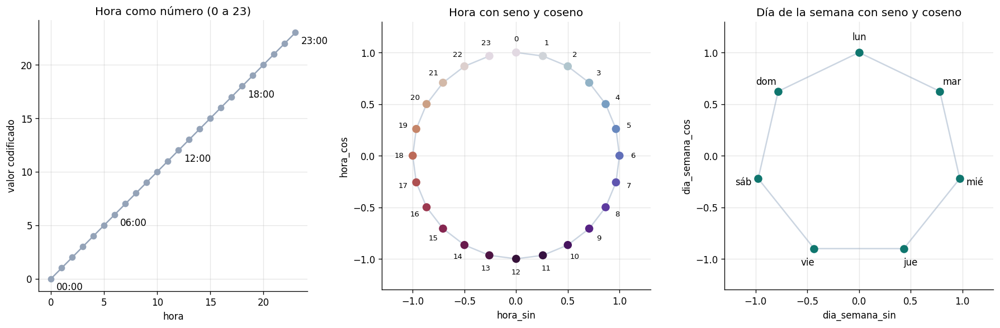
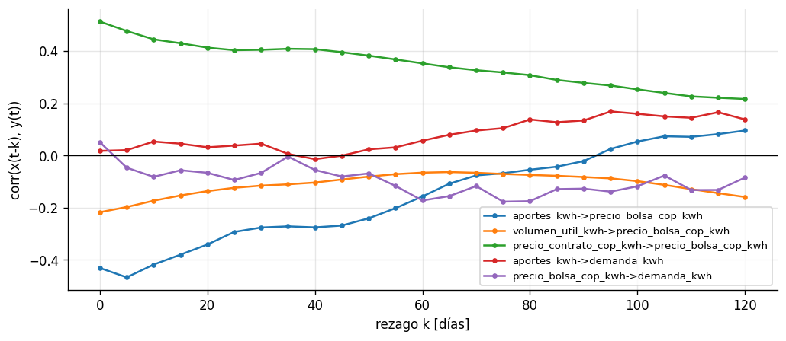
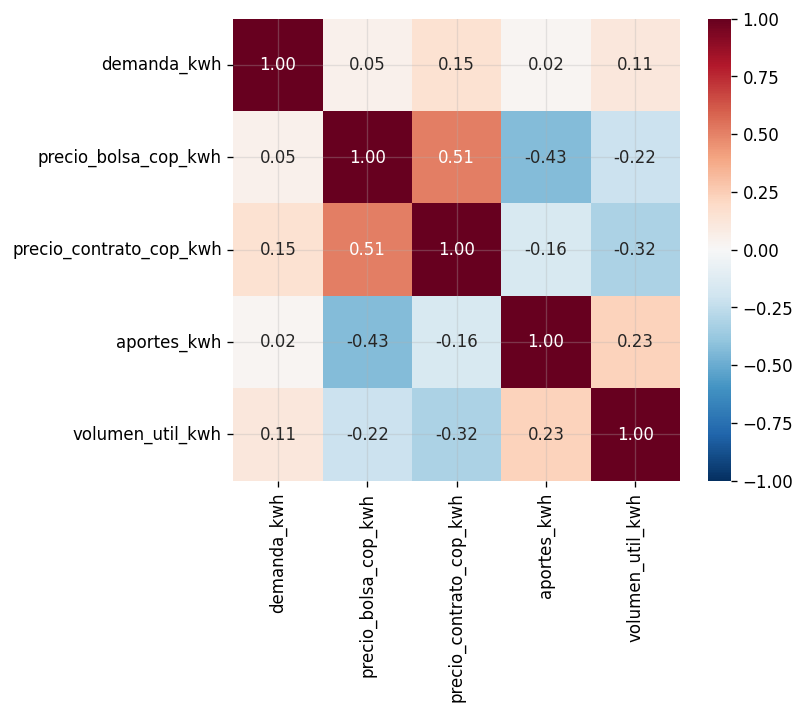
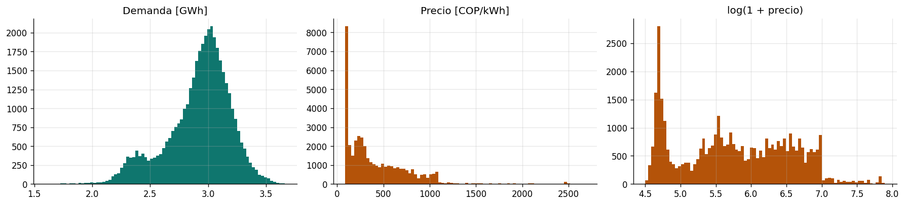
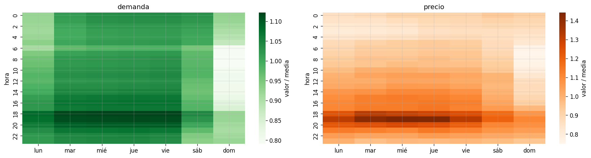
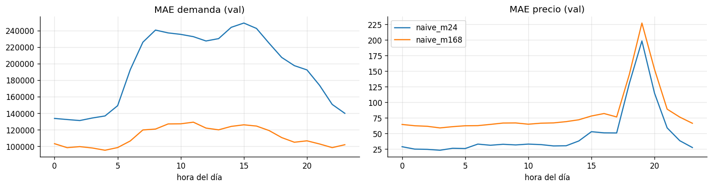

# Resumen

El proyecto pronostica, para las **24 horas del día siguiente**, dos variables del mercado eléctrico colombiano: la **demanda de energía de los usuarios no regulados** y el **precio de bolsa nacional**. Se trabaja con datos horarios de XM entre el 1 de enero de 2022 y el 31 de agosto de 2026 (40.896 horas).

El trabajo se organiza en tres fases:

| Fase | Contenido | Estado |
|---|---|---|
| **1. Datos** | Planteamiento, estandarización de la base de datos, análisis estadístico de las dos series, feature engineering y pipeline de datos | **Completa (Por Revisar)** |
| **2. Modelamiento** | Diseño, entrenamiento y comparación de cinco arquitecturas de redes neuronales: RNN, TCN, GRU, LSTM y Transformer | Por hacer |
| **3. Optimización** | Optimización de los dos modelos ganadores de la fase 2 | Por hacer |

Este documento explica qué se hizo en la fase 1, por qué se tomó cada decisión, lo que haremos en las fases 2 y 3, y cómo está organizado el repositorio para que todos trabajemos sobre la misma base.

# Contexto

## El mercado eléctrico colombiano

En el Mercado de Energía Mayorista (MEM) de Colombia los comercializadores y los grandes consumidores compran energía por dos vías:

- **Contratos bilaterales:** acuerdos de largo plazo con precio pactado, negociados con meses o años de anticipación.
- **Bolsa de energía (mercado spot):** la energía no cubierta por contratos se liquida al **precio de bolsa**, que se forma cada hora a partir de las ofertas de los generadores y de la demanda del sistema.

El operador del sistema y administrador del mercado es **XM S.A. E.S.P.**, que publica la información operativa y comercial (precios, demanda, hidrología) en su portal y en una API pública.

La matriz de generación del país es predominantemente **hidráulica**. Por eso el estado de los embalses y los aportes de los ríos condicionan la oferta y, con ella, el precio de bolsa. En los periodos secos, asociados al fenómeno de El Niño, el precio puede multiplicarse varias veces en pocas semanas.

## Usuarios no regulados

Un **usuario no regulado** es un consumidor con una demanda máxima superior a **0,1 MW** o un consumo mensual superior a **55 MWh** (Resolución CREG 131 de 1998, artículo 2). Son, en su mayoría, industrias y grandes comercios que pueden negociar libremente el precio de su energía.

Estos usuarios enfrentan una doble incertidumbre:

1. **Su propia demanda**, que depende de los ciclos de producción, los turnos y el calendario.
2. **El precio de bolsa**, que es volátil y depende de la hidrología y de las condiciones del sistema.

Anticipar ambas variables hora a hora es el insumo básico de cualquier estrategia de compra de energía.

# Planteamiento del problema {#sec-planteamiento}

El proyecto se enfoca en pronosticar, hora a hora, la demanda de los usuarios no regulados y el precio de bolsa del día siguiente. Sobre ese problema comparamos cinco arquitecturas de redes neuronales y luego optimizamos las que mejor se desempeñen.

Es un problema de **regresión multivariada**. A las 00:00 del día $D+1$, con la información disponible hasta ese instante, se pronostican las 24 horas de ese día:

$$
\widehat{\mathbf{Y}}_{D+1} =
\begin{bmatrix}
\widehat{D}_{t_0} & \widehat{P}_{t_0} \\
\vdots & \vdots \\
\widehat{D}_{t_0+23} & \widehat{P}_{t_0+23}
\end{bmatrix}
= f\big(\mathbf{X}_{t_0-168\,:\,t_0},\; \mathbf{C}_{t_0\,:\,t_0+24};\; \mathbf{w}\big) \in \mathbb{R}^{24\times 2}
$$

donde:

- $\widehat{D}_t$ es la demanda no regulada pronosticada [kWh] y $\widehat{P}_t$ el precio de bolsa pronosticado [COP/kWh].
- $\mathbf{X}_{t_0-168:t_0}$ es la historia de las últimas 168 horas: las dos series objetivo, las variables exógenas y el calendario (16 variables).
- $\mathbf{C}_{t_0:t_0+24}$ es el calendario de las 24 horas a pronosticar (9 variables), que se conoce de antemano.
- $\mathbf{w}$ son los pesos de la red neuronal.

Los pesos se obtienen minimizando el error cuadrático medio sobre las salidas estandarizadas:

$$
\min_{\mathbf{w}} \; \mathcal{L}(\mathbf{w}) = \frac{1}{N}\sum_{i=1}^{N} \frac{1}{48}\left\lVert \mathbf{Y}_i - \widehat{\mathbf{Y}}_i \right\rVert_F^2
$$

Las dos salidas se estandarizan (el precio después de una transformación logarítmica), así ninguna domina la pérdida por su escala: la demanda está en millones de kWh y el precio en cientos de COP/kWh.

# Base de datos {#sec-datos}

## Fuente y variables

Todos los datos provienen de la API pública de XM, consultada con el paquete de Python `pydataxm`.

| Variable | Métrica XM | Resolución | Unidad | Rol en el modelo |
|---|---|---|---|---|
| Demanda comercial no regulada | `DemaComeNoReg` | horaria | kWh | **objetivo** |
| Precio de bolsa nacional | `PrecBolsNaci` | horaria | COP/kWh | **objetivo** |
| Precio promedio de contratos, mercado no regulado | `PrecPromContNoRegu` | horaria | COP/kWh | exógena |
| Aportes hídricos en energía | `AporEner` | diaria | kWh | exógena |
| Volumen útil diario de embalses en energía | `VoluUtilDiarEner` | diaria | kWh | exógena |

**Periodo:** 2022-01-01 a 2026-08-31, es decir, 1.704 días o 40.896 horas. Todas las métricas son agregadas a nivel de sistema y no contienen información de usuarios individuales.

## Por qué estas variables exógenas

- **Precio de contratos:** refleja las condiciones del mercado de largo plazo y está parcialmente indexado al precio de bolsa.
- **Aportes hídricos y volumen útil:** como la generación es mayoritariamente hidráulica, el estado de los embalses y de los ríos es un indicador adelantado de escasez y condiciona el nivel del precio.

## Qué representan las variables hidrológicas {#sec-hidrologia}

Los aportes hídricos y el volumen útil son **variables físicas** del sistema hidráulico, no de mercado. Es fácil confundirlas, así que esta es la convención que usamos en todo el proyecto:

| | Aportes hídricos (`aportes_kwh`) | Volumen útil (`volumen_util_kwh`) |
|---|---|---|
| **Qué mide** | El agua que llega por los ríos a los embalses y centrales hidráulicas durante el día | El agua almacenada en los embalses por encima del nivel mínimo técnico, es decir, la que todavía se puede usar para generar |
| **Analogía** | Lo que **entra** al tanque ese día | Lo que **hay** en el tanque |
| **Tipo de variable** | Flujo (por día) | Inventario (nivel acumulado) |
| **Qué la mueve** | Las lluvias en las cuencas de los días y semanas anteriores, las temporadas de lluvia y sequía, y los fenómenos de El Niño y La Niña | Lo que entra por aportes menos lo que sale para generar energía |
| **Ojo** | No es la lluvia en sí: es el caudal de los ríos, que depende de la lluvia pero llega con retraso | No es la capacidad total del embalse, solo la parte aprovechable |
| **Unidad** | kWh: XM convierte el agua en la energía que podría generarse con ella | kWh, con la misma conversión |
| **Velocidad de cambio** | Varía de un día a otro, pero sigue la temporada durante semanas | Muy lenta: semanas o meses |
| **Relación esperada con el precio** | Menos aportes → más escasez → precio más alto | Embalses bajos → precio más alto |

Las dos tienen una **dinámica lenta (alta inercia)**: lo que reporta XM para un día describe bien el estado del sistema en todas las horas del día siguiente. Esta característica es clave para la decisión de granularidad.

## Formato crudo

- **Métricas horarias:** XM las entrega en formato ancho, con una fila por día y las columnas `Values_Hour01` a `Values_Hour24`. `Values_Hour01` corresponde al periodo de 00:00 a 01:00.
- **Métricas diarias:** columnas `Date` y `Value`.

Los cinco archivos crudos tienen 1.704 filas cada uno, sin fechas duplicadas ni valores nulos.

## Calidad de los datos

Después de la estandarización (cuaderno `02_estandarizacion`):

- El índice horario es continuo de principio a fin, sin horas faltantes ni duplicadas.
- No hay valores nulos, ceros ni negativos en ninguna variable.
- Las variables diarias toman un único valor dentro de cada día.

# Pipeline de datos {#sec-pipeline}

## Visión general {#sec-vision}

Antes de entrar en el detalle, conviene ver el recorrido completo. Los datos salen de la API de XM, pasan por tres carpetas (crudos, estandarizados y con variables) y terminan convertidos en las ventanas que van a recibir nuestras redes. Cada flecha del diagrama es un módulo de `src/energia/`, así que si algo falla o hay que cambiarlo, sabremos exactamente dónde está el error.

```{mermaid}
flowchart TD
    A[(API XM<br/>pydataxm)] -->|xm.py| B[data/raw<br/>5 CSV de XM]
    B -->|preprocesamiento.py| C[data/interim<br/>dataset_horario.parquet<br/>40.896 × 5]
    C -->|features.py| D[data/processed<br/>dataset_features.parquet<br/>40.704 × 16]
    D -->|dataset.py| E[Ventanas en memoria<br/>pasado · futuro · y]
    E --> F[Fase 2<br/>redes neuronales]
    D -.->|escalador.json| E
```

Todo el pipeline se ejecuta con un solo comando:

```bash
python scripts/construir_dataset.py
```

O paso a paso, con los cuadernos de `notebooks/fase1_datos/`:

| Cuaderno | Entrada | Salida | Qué hace |
|---|---|---|---|
| `01_descarga_xm` | API de XM | `data/raw/*.csv` | Descarga (opcional) e inventario de los archivos crudos |
| `02_estandarizacion` | `data/raw` | `data/interim` | Formato largo, índice horario continuo, validación |
| `03_analisis_estadistico` | `data/interim` | `reports/figuras/03_*.png` | Análisis estadístico de las dos series (sección [-@sec-analisis]) |
| `04_feature_engineering` | `data/interim` | `data/processed/*` | Variables derivadas, revisión de fuga de información, escalado, ventanas, líneas base |

## Etapa 1 · Estandarización (`raw → interim`) {#sec-estandarizacion}

XM entrega cada variable en su propio archivo y con su propio formato: las horarias vienen en una tabla ancha con una columna por hora, y las diarias en una tabla de fecha y valor. En esta etapa juntamos todo en una sola tabla horaria, ordenada y revisada. Es la etapa menos vistosa, pero si aquí se cuela una hora faltante o duplicada, todo lo que viene después queda mal.

1. Cada métrica horaria pasa del formato ancho de XM (día × 24 horas) a una serie con índice `fecha_hora`.
2. Las métricas diarias se leen en su resolución nativa.
3. Todo se reindexa contra un calendario horario **completo**. Si faltara una hora, aparecería como valor nulo y la validación fallaría. Antes, con un `merge` de tipo *inner*, esa hora se habría perdido sin aviso.
4. Cada valor diario se repite en las 24 horas de su día, todavía **sin rezago**.
5. Se valida la serie (índice continuo, sin nulos, objetivos positivos) y se guarda.

Nombres estandarizados de las columnas:

| Columna | Descripción |
|---|---|
| `demanda_kwh` | Demanda comercial no regulada |
| `precio_bolsa_cop_kwh` | Precio de bolsa nacional |
| `precio_contrato_cop_kwh` | Precio promedio de contratos no regulados |
| `aportes_kwh` | Aportes hídricos del día |
| `volumen_util_kwh` | Volumen útil de embalses del día |

## Etapa 2 · Feature engineering (`interim → processed`) {#sec-features}

Con la tabla limpia, la pregunta es qué información le damos a la red. La regla que seguimos fue sencilla: solo puede entrar lo que alguien realmente sabría a las 00:00 del día que queremos pronosticar. A partir de ahí creamos variables nuevas a partir de la hidrología y del calendario, y las organizamos según el momento en que se conocen.

Las variables se agrupan según **cuándo se conocen**:

| Grupo | Variables | Cuándo se conocen |
|---|---|---|
| **Objetivos** (también como historia) | `demanda_kwh`, `precio_bolsa_cop_kwh` | Hasta el instante del pronóstico |
| **Covariables pasadas** | `precio_contrato_cop_kwh`, `aportes_kwh_d1`, `aportes_media7_kwh_d1`, `volumen_util_kwh_d1`, `volumen_util_delta7_kwh_d1` | Hasta el instante del pronóstico |
| **Covariables futuras** (calendario) | `hora_sin`, `hora_cos`, `dia_semana_sin`, `dia_semana_cos`, `dia_anio_sin`, `dia_anio_cos`, `es_festivo`, `es_sabado`, `es_domingo_o_festivo` | De antemano, para cualquier fecha |

**Variables hidrológicas derivadas.** Además del nivel de aportes y de volumen útil, se incluyen la media móvil de 7 días de los aportes, que suaviza el ruido diario, y la diferencia de 7 días del volumen útil. Como el volumen se mueve muy despacio, su cambio informa más que su nivel (sección [-@sec-exogenas]).

**Calendario.**

**Codificación cíclica (seno y coseno).** La hora, el día de la semana y el día del año son variables **cíclicas**: después de las 23:00 viene otra vez las 00:00. Si la hora entrara como un número de 0 a 23, la red interpretaría que las 23:00 y las 00:00 están a 23 unidades de distancia, cuando en realidad son consecutivas, y que el salto entre ellas es el más grande posible. Para evitarlo, cada variable cíclica $x$ con periodo $T$ se transforma en dos:

$$
x_{\sin} = \sin\!\left(\frac{2\pi x}{T}\right), \qquad x_{\cos} = \cos\!\left(\frac{2\pi x}{T}\right)
$$

con $T = 24$ para la hora, $T = 7$ para el día de la semana y $T = 365{,}25$ para el día del año. Así cada valor queda como un punto sobre un círculo:

| Hora | Como número | `hora_sin` | `hora_cos` |
|---|---|---|---|
| 00:00 | 0 | 0,00 | 1,00 |
| 06:00 | 6 | 1,00 | 0,00 |
| 12:00 | 12 | 0,00 | −1,00 |
| 18:00 | 18 | −1,00 | 0,00 |
| 23:00 | 23 | −0,26 | 0,97 |

Las 23:00 y las 00:00 quedan cerca, igual que el domingo y el lunes, o el 31 de diciembre y el 1 de enero. Hacen falta **las dos** componentes porque con solo el seno dos horas distintas tendrían el mismo valor: las 05:00 y las 07:00 dan ambas 0,97. Además, los valores quedan en $[-1, 1]$ y no hay que escalarlos. Una alternativa sería *one-hot* (24 columnas para la hora, 7 para el día), pero multiplica el número de variables y pierde la noción de cercanía entre horas vecinas.



**Festivos.** Se calculan con la Ley 51 de 1983 (Ley Emiliani), con tres tipos de fecha: fijas (1 de enero, 1 de mayo, 20 de julio, 7 de agosto, 8 y 25 de diciembre), trasladables al lunes siguiente (Reyes, San José, San Pedro, Asunción, Día de la Raza, Todos los Santos, Independencia de Cartagena) y dependientes de la Pascua (Jueves y Viernes Santo, Ascensión, Corpus Christi y Sagrado Corazón). La fecha de la Pascua se obtiene con el algoritmo de Meeus/Jones/Butcher. Todo está implementado en `festivos.py` sin dependencias externas y se verificó contra el calendario oficial de 2024. El periodo tiene 84 festivos (83 en el dataset final, que empieza el 9 de enero de 2022). Por qué se necesitan se explica en la sección [-@sec-estacionalidad].

::: {.callout-important}
## Prevención de fuga de información

Los aportes y el volumen útil de un día solo se conocen cuando ese día termina. Si en las horas del día $d$ se usara el valor del mismo día $d$, el modelo "vería el futuro" durante el entrenamiento y su desempeño real sería peor que el medido.

Por eso, **en todas las horas del día $d$ se usa el valor del día $d-1$** (`REZAGO_EXOGENAS_DIARIAS = 1`). Las variables derivadas (media de 7 días y Δ de 7 días) se calculan antes de aplicar el rezago. El cuaderno 04 comprueba automáticamente que cada hora use exactamente el valor del día anterior; si encontrara una sola hora con el valor equivocado, el cuaderno se detiene con un error.
:::

Las primeras 8 jornadas se descartan porque quedan incompletas por la diferencia de 7 días y el rezago de 1 día. El dataset final tiene **40.704 horas × 16 variables**.

## Etapa 3 · Escalado {#sec-escalado}

Las variables viven en escalas muy distintas: la demanda está en millones de kWh, el precio en cientos de COP/kWh y el volumen útil en miles de millones de kWh. Si se las pasamos así a la red, las de números más grandes dominan el entrenamiento. En esta etapa las llevamos a escalas comparables, sin perder la posibilidad de volver a las unidades reales cuando calculemos los errores.

| Transformación | Columnas | Motivo |
|---|---|---|
| `log1p` y luego z-score | precio de bolsa, aportes y media de 7 días de aportes | Asimetría fuerte (sección [-@sec-distribuciones]) |
| z-score | demanda, precio de contratos, volumen útil, Δ de 7 días del volumen | Escalas muy distintas entre variables |
| Ninguna | calendario | Ya está en [−1, 1] o en {0, 1} |

Las medias y desviaciones se calculan **solo con los datos de entrenamiento**, se guardan en `escalador.json` y se aplican igual a validación y prueba. La transformación inversa (`Escalador.invertir`) devuelve las predicciones a kWh y COP/kWh con un error relativo máximo de 5,5 × 10⁻⁸.

::: {.callout-note}
## Transformación logarítmica frente a penalizar los picos

La transformación `log1p` del precio **no se hizo para volver la serie estacionaria**: la prueba de Dickey-Fuller ya rechaza la raíz unitaria en resolución horaria (sección [-@sec-estacionariedad]). Se hizo por la forma de la distribución (sección [-@sec-distribuciones]) y tiene tres efectos:

1. **Evita que los picos dominen la pérdida.** El MSE eleva el error al cuadrado. Sin transformar, un error de 1.000 COP/kWh en un pico de 2.600 pesa más que miles de errores pequeños en días normales.
2. **Estabiliza la varianza.** La volatilidad del precio crece con su nivel: con el logaritmo, las variaciones proporcionales quedan de tamaño parecido en cualquier régimen.
3. **Equilibra los dos objetivos.** Tras log y z-score, la demanda y el precio llegan a la red en escalas comparables.

**El costo.** En escala logarítmica el MSE se comporta como un **error relativo**: equivocarse un 20 % en 200 COP/kWh pesa casi lo mismo que equivocarse un 20 % en 2.000 COP/kWh. La red aprende mejor el comportamiento típico del precio, pero castiga menos los errores absolutos grandes en las horas más caras. La propuesta inicial justificaba el MSE precisamente porque "penaliza cuadráticamente los picos", así que hay una tensión entre las dos ideas.

Ninguna opción es correcta por defecto; depende de qué error le cuesta más al usuario:

| Prioridad | Configuración |
|---|---|
| Acertar el comportamiento típico del precio | Con logaritmo (configuración actual) |
| No subestimar las horas más caras | Sin logaritmo: quitar `precio_bolsa_cop_kwh` de `config.COLUMNAS_LOG` |
:::

## Etapa 4 · Ventanas y partición {#sec-ventanas}

Las redes no leen una tabla larga: aprenden de ejemplos de la forma "con esta semana de historia, esto fue lo que pasó al día siguiente". En esta etapa cortamos la serie en esos ejemplos y la dividimos en entrenamiento, validación y prueba, respetando siempre el orden del tiempo. El resultado son los tensores con los que cada uno va a trabajar en la fase 2.

`dataset.cargar_datos_modelo()` arma en memoria los tensores que reciben las redes:

| Tensor | Forma | Contenido |
|---|---|---|
| `pasado` | (N, 168, 16) | Últimas 168 h de las 16 variables, escaladas |
| `futuro` | (N, 24, 9) | Calendario de las 24 h a pronosticar |
| `y` | (N, 24, 2) | Demanda y precio de las 24 h, escalados |

**Partición cronológica**, sin barajar:

| Partición | Periodo | Muestras | Instante de emisión |
|---|---|---|---|
| Entrenamiento | 2022-01-16 a 2025-06-30 | 30.265 | Cada hora (paso de 1 h) |
| Validación | 2025-07-01 a 2025-12-31 | 184 | 00:00 de cada día |
| Prueba | 2026-01-01 a 2026-08-31 | 243 | 00:00 de cada día |

- En **entrenamiento** se genera una ventana por hora para aprovechar al máximo los datos. Las ventanas se solapan, lo que actúa como aumento de datos.
- En **validación y prueba** se evalúa exactamente el caso de uso: un pronóstico por día, emitido a las 00:00.
- La historia de una ventana de validación puede incluir horas del periodo de entrenamiento: es pasado y se conoce. Los **objetivos** de las tres particiones no se solapan nunca, y el cuaderno 04 lo comprueba.

::: {.callout-note}
En float32, el tensor de entrenamiento ocupa unos 330 MB. Para prototipar rápido se puede subir `PASO_ENTRENAMIENTO` (por ejemplo, a 3). Los resultados finales se reportan con el valor por defecto.
:::

# Análisis estadístico de las series {#sec-analisis}

Todo lo de esta sección se reproduce con el cuaderno `03_analisis_estadistico`.

## Vista general {#sec-vistageneral}


**Promedios anuales:**

| Año | Demanda [GWh/h] | Precio bolsa [COP/kWh] | Precio contratos [COP/kWh] | Aportes [GWh/día] | Volumen útil [GWh] |
|---|---|---|---|---|---|
| 2022 | 2,85 | 215,8 | 259,5 | 221,3 | 13.150 |
| 2023 | 2,91 | 558,1 | 277,5 | 190,2 | 12.705 |
| 2024 | 2,86 | 676,1 | 305,0 | 168,4 | 8.972 |
| 2025 | 2,97 | 240,3 | 289,9 | 248,6 | 12.470 |
| 2026 | 3,06 | 455,6 | 307,6 | 198,5 | 12.392 |

- **Demanda.** Crece de forma suave, un 7 % entre 2022 y 2026, con caídas marcadas en fines de semana, festivos y fin de año. Desde el segundo semestre de 2025 su nivel sube a unos 3,03–3,09 GWh/h por trimestre, frente a 2,85–2,92 en entrenamiento. **Validación y prueba quedan por encima de casi todo lo visto en entrenamiento.**
- **Precio de bolsa.** Lo dominan los **regímenes hidrológicos**: de unos 216 COP/kWh en 2022 pasa a 676 en 2024, cuando los embalses llegaron a su mínimo después de El Niño 2023–2024, y vuelve a 240 en 2025. La volatilidad crece con el nivel del precio.

## Regímenes de precio e hidrología {#sec-regimenes}


Los periodos de precio alto coinciden con caídas del volumen útil y de los aportes. El episodio más extremo es el de septiembre a noviembre de 2024, con embalses en mínimos y el precio diario por encima de 1.500 COP/kWh.

## Relación con las variables exógenas {#sec-exogenas}



| Rezago k [días] | Aportes → precio | Volumen → precio | Contratos → precio | Aportes → demanda | Precio → demanda |
|---|---|---|---|---|---|
| 0 | −0,43 | −0,22 | 0,51 | 0,02 | 0,05 |
| 15 | −0,38 | −0,15 | 0,43 | 0,04 | −0,06 |
| 30 | −0,28 | −0,12 | 0,40 | 0,04 | −0,07 |
| 60 | −0,16 | −0,07 | 0,35 | 0,06 | −0,17 |
| 90 | −0,02 | −0,08 | 0,28 | 0,13 | −0,13 |

{width=55%}

- **Aportes → precio:** es la relación más fuerte (−0,43). Decae despacio y sigue siendo relevante durante 30 a 60 días. Es una señal de **régimen**, no de la hora a hora.
- **Volumen útil → precio:** es negativa pero más débil (−0,22). Como el volumen cambia muy despacio, se incluye también su diferencia de 7 días.
- **Contratos ↔ bolsa:** correlación de +0,51, por la indexación parcial de los contratos al precio de bolsa.
- **Exógenas → demanda:** la relación es prácticamente nula. La demanda no regulada se explica por su propia historia y por el calendario. En el corto plazo no reacciona al precio de bolsa.
- Todas las relaciones fuertes se dan a **escala diaria o semanal**, lo que pesa en la decisión de granularidad (sección [-@sec-granularidad]).

## Distribuciones {#sec-distribuciones}



| Variable | Media | CV [%] | Asimetría | Curtosis (exceso) |
|---|---|---|---|---|
| Demanda [kWh] | 2.920.097 | 9,5 | −0,78 | 0,64 |
| Precio bolsa [COP/kWh] | 427,4 | 83,3 | **1,99** | **6,45** |
| log(1 + precio) | 5,76 | 13,7 | 0,14 | −1,02 |
| Precio contratos [COP/kWh] | 286,5 | 7,0 | 0,01 | −0,20 |
| Aportes [kWh] | 2,06 × 10⁸ | 44,6 | 0,97 | 1,34 |
| log(1 + aportes) | 19,04 | 2,4 | −0,30 | −0,12 |
| Volumen útil [kWh] | 1,19 × 10¹⁰ | 20,0 | −0,65 | −0,04 |

El precio tiene una cola derecha pesada: asimetría de 2, curtosis de 6,5 y un coeficiente de variación del 83 %. Con `log1p` la asimetría baja a 0,14. Por eso se transforman el precio y los aportes antes de estandarizar: sin la transformación, la pérdida MSE quedaría dominada por unos pocos picos. La demanda es casi simétrica y solo se estandariza.

## Estacionalidad diaria, semanal y festivos {#sec-estacionalidad}




**Diferencia respecto a un día laboral:**

| Tipo de día | Demanda | Precio |
|---|---|---|
| Sábado | −5,1 % | −4,9 % |
| Domingo o festivo | −17,4 % | −13,1 % |

- **Demanda.** El perfil intradía es **escalonado**: baja de golpe a las 06:00 y sube de golpe a las 18:00, con el máximo entre las 18:00 y las 20:00. En domingos y festivos la caída de las 06:00 es mucho más profunda. Los festivos se comportan como domingos, por eso hace falta un indicador explícito de festivo.
- **Precio.** El pico está entre las 18:00 y las 20:00, entre un 25 % y un 40 % por encima de la media en días laborales, y el valle está en la madrugada.
- Un modelo con resolución diaria no podría representar ninguno de los dos perfiles.

**El efecto de los festivos.** Por la Ley Emiliani, la mayoría de los festivos cae entre semana: **76 de los 84** del periodo, 52 de ellos en lunes. Se comparó la demanda media diaria por tipo de día:

| Tipo de día | Días | Demanda media [GWh/h] | Variación vs. laboral |
|---|---|---|---|
| Laboral | 1.140 | 3,04 | — |
| Sábado | 244 | 2,88 | −5,3 % |
| **Festivo entre semana** | **76** | **2,53** | **−16,8 %** |
| Domingo | 244 | 2,51 | −17,5 % |

**Para la demanda no regulada, un festivo es un domingo.** Esto tiene una consecuencia directa: un modelo que solo conoce el día de la semana espera un consumo de lunes normal en un lunes festivo y se equivoca por cerca de un 17 %. El naive con $m = 168$ lo muestra:

| Días evaluados | MAPE diario de la demanda (naive $m = 168$) |
|---|---|
| Laborales normales | 2,4 % |
| Festivos entre semana | **15,3 %** |

El error se multiplica por más de seis. Por eso se incluyen tres indicadores de calendario además de la codificación cíclica:

- `es_festivo`: marca el día festivo.
- `es_domingo_o_festivo`: agrupa los dos tipos de día con el mismo comportamiento.
- `es_sabado`: el sábado es un día intermedio.

El seno y el coseno del día de la semana no bastan, porque no saben que **un lunes concreto** es festivo. Esa información solo la aporta el calendario.

## Autocorrelación (ACF y PACF) {#sec-acf}


Las dos funciones responden preguntas distintas:

- La **ACF** mide cuánto se parece la serie a sí misma $k$ horas atrás, **incluyendo los efectos indirectos**. Si la hora $t$ se parece a $t-1$, y $t-1$ a $t-2$, la ACF en el rezago 2 hereda parte de esa relación.
- La **PACF** mide la relación con el rezago $k$ **descontando los rezagos intermedios**. Indica qué rezagos aportan información nueva.

| Rezago [h] | 1 | 2 | 24 | 25 | 48 | 168 | 169 | 336 |
|---|---|---|---|---|---|---|---|---|
| ACF demanda | 0,97 | 0,94 | 0,52 | 0,48 | 0,16 | **0,77** | 0,75 | 0,70 |
| PACF demanda | **0,97** | −0,09 | −0,22 | **−0,60** | −0,06 | −0,15 | **−0,28** | −0,07 |
| ACF log(precio) | 0,97 | 0,95 | **0,94** | 0,93 | 0,91 | 0,81 | 0,81 | 0,71 |
| PACF log(precio) | **0,97** | 0,07 | 0,10 | **−0,22** | 0,04 | 0,03 | −0,07 | 0,01 |

- **Demanda.** En la ACF, la autocorrelación a 168 h (0,77) supera a la de 24 h (0,52): **el patrón dominante es semanal**, y un lunes se parece más al lunes anterior que al domingo previo. La PACF lo confirma desde otro ángulo. Después del rezago 1, los picos más fuertes aparecen justo después de 24 h (rezago 25: −0,60) y de 168 h (rezago 169: −0,28), que es la huella típica de una estacionalidad diaria y semanal superpuestas. También hay un pico en 13 h (+0,55), coherente con los escalones de las 06:00 y las 18:00, separados por 12 horas.
- **Precio.** La ACF decae muy despacio en todos los rezagos, lo típico de una serie que cambia de nivel por régimen. La PACF muestra que casi toda esa memoria se explica por el rezago 1 más una estructura diaria (rezagos de 19 a 25 h). El aporte semanal propio es prácticamente nulo.
- Con más de 40.000 datos, la banda de confianza es muy estrecha (±0,01) y casi cualquier rezago resulta "significativo". Por eso se interpreta la **magnitud** de los picos y no solo si salen de la banda.
- **Decisión:** se usa una ventana de **168 horas** (una semana). Es la mínima que contiene los rezagos diario y semanal que señalan ambas funciones.

## Estacionariedad {#sec-estacionariedad}

Prueba de Dickey-Fuller aumentada con constante (valores críticos de MacKinnon: −3,43 al 1 % y −2,86 al 5 %):

| Serie | Estadístico ADF | ¿Rechaza raíz unitaria al 5 %? |
|---|---|---|
| Demanda (horaria) | −28,0 | Sí |
| Demanda, diferencia de 24 h | −25,2 | Sí |
| log(precio) (horario) | −3,96 | Sí |
| log(precio), diferencia de 24 h | −29,1 | Sí |
| log(precio) (diario) | −3,34 | Sí, pero no al 1 % |

En resolución horaria ambas series son estacionarias según la prueba. En resolución diaria la evidencia para el precio es débil: a escala de semanas y meses el precio se mueve entre regímenes de forma muy persistente.

**Implicación para el modelado.** No hace falta diferenciar ni descomponer las series para que las redes aprendan los patrones horario y semanal. Lo difícil es el **nivel** del precio, que depende de la hidrología, y para eso están las variables hidrológicas. Las redes reciben los niveles transformados más el calendario.

## Valores atípicos {#sec-atipicos}

Con el criterio de 3 rangos intercuartílicos:

- **Precio:** 291 horas atípicas (0,71 %). Se concentran entre septiembre y noviembre de 2024: hay días completos por encima del umbral (por ejemplo, del 31 de octubre al 3 de noviembre de 2024).
- **Demanda:** 39 horas atípicas (0,10 %), todas en domingos o festivos, sobre todo a fin de año.

**No se eliminan.** Los picos de precio no son errores de medición: son justamente lo que interesa anticipar. La transformación `log1p` reduce su peso en la pérdida sin borrar la información. Las caídas de demanda las explica el indicador de festivo.

## Cambio estructural del precio intradía desde 2025 {#sec-cambio}

Desde 2025 el precio horario muestra picos muy por encima de su media diaria, algo que casi no ocurría antes:

| Semestre | Rango intradía medio [% de la media diaria] | Máximo / mediana diaria | Partición |
|---|---|---|---|
| 2022-S1 | 30 | 1,06 | train |
| 2022-S2 | 46 | 1,05 | train |
| 2023-S1 | 46 | 1,08 | train |
| 2023-S2 | 53 | 1,08 | train |
| 2024-S1 | 45 | 1,10 | train |
| 2024-S2 | 61 | 1,13 | train |
| 2025-S1 | 107 | 1,32 | train |
| **2025-S2** | **177** | **2,28** | **val** |
| 2026-S1 | 93 | 1,42 | test |
| 2026-S2 (jul–ago) | 38 | 1,16 | test |


El pico de 18:00 a 20:00 pasa de unas 1,2 veces la media del periodo (2022–2024) a 1,7 veces en 2025-S1 y 2,2 veces en 2025-S2. Es un **cambio en la forma** del perfil, no solo en su nivel.

::: {.callout-warning}
## Consecuencias para las fases 2 y 3

1. **Validación es el periodo más difícil** y no representa a la mayor parte del entrenamiento. Es esperable que el error de precio en validación sea mayor que en prueba.
2. Se mantiene la partición porque el entrenamiento ya incluye el comienzo del fenómeno (2025-S1). Validar con 2025-S1 dejaría a la red sin ningún ejemplo del nuevo comportamiento.
3. Se reportarán siempre las métricas de validación **y** de prueba.
:::

# Decisión de granularidad {#sec-granularidad}

Las variables objetivo son horarias, pero dos de las exógenas (aportes y volumen útil) solo existen a nivel diario. Se evaluaron tres opciones:

| | A. Todo diario | B. Todo horario, exógenas interpoladas | **C. Horario con exógenas diarias rezagadas** |
|---|---|---|---|
| Tamaño | 1.704 días | 40.896 horas | 40.896 horas (30.265 ventanas de entrenamiento) |
| Objetivo | Media diaria | Horario | Horario |
| Pérdida de información | 21 % de la varianza de la demanda y todo el perfil horario del precio | Ninguna | Ninguna |
| Riesgo | Muy pocas muestras para redes profundas | Inventa variación horaria que XM no mide; fuga si se usa el valor del mismo día | Ninguno: se usa el valor de d−1 en las 24 h |
| Decisión | ✗ | ✗ | **✓** |

**Cuánta información vive dentro del día:**

| Serie | % varianza entre días | % varianza intradía | Rango intradía medio [% media diaria] |
|---|---|---|---|
| Demanda | 78,6 | **21,4** | 15,2 |
| Precio | 90,1 | 9,9 | **71,9** |
| log(precio) | 89,8 | 10,2 | — |

| Partición | % varianza intradía, demanda | % varianza intradía, log(precio) |
|---|---|---|
| Entrenamiento | 21,8 | 8,5 |
| Validación | 25,7 | **45,3** |
| Prueba | 27,2 | 10,0 |

**Se elige la resolución horaria (opción C)** por cinco razones:

1. **El problema es horario.** El 21 % de la varianza de la demanda ocurre dentro del día y el precio oscila en promedio un 72 % de su media diaria. Además, la parte intradía del precio está creciendo: es el 45 % de la varianza en validación. Agregar a diario borraría justo lo que más ha cambiado y lo que el usuario necesita saber: cuánto y a qué precio en cada hora.
2. **Volumen de datos.** Con datos diarios quedarían unas 1.200 muestras de entrenamiento, insuficientes para una LSTM o un Transformer. Con datos horarios hay unas 30.000.
3. **Las variables diarias no obligan a agregar.** Su relación con el precio se da a escala diaria o semanal (sección [-@sec-exogenas]), así que basta con repetir su valor en las 24 horas del día. No se interpolan: interpolar inventaría una variación horaria que no existe.
4. **La naturaleza física de esas variables lo permite.** Los aportes y el volumen útil tienen una dinámica lenta (sección [-@sec-hidrologia]): un embalse no se vacía ni se llena de una hora a otra, y el caudal de los ríos responde a lluvias de días anteriores. Por eso el valor reportado para el día anterior describe bien el estado del sistema en cada una de las 24 horas siguientes, y repetirlo hora a hora es físicamente coherente.
5. **Sin fuga de información.** Se usa el valor del día d−1 en todas las horas del día d.

# Líneas base {#sec-lineasbase}

Antes de entrenar cualquier red hay que saber cuánto error se obtiene sin aprender nada. Se usa el modelo **naive estacional** (*seasonal naïve*), la referencia estándar en pronóstico de series de tiempo (Hyndman y Athanasopoulos, 2021, sección 5.2):

$$
\hat{y}_{t} = y_{t-m}
$$

donde $m$ es el periodo estacional en horas. Se evalúan dos periodos:

- **Naive $m = 24$:** la hora $h$ de mañana se pronostica con la hora $h$ de hoy.
- **Naive $m = 168$:** la hora $h$ de mañana se pronostica con la hora $h$ del mismo día de la semana anterior.

| Modelo | Partición | MAE demanda [kWh] | MAPE demanda [%] | MAE precio [COP/kWh] | MAPE precio [%] | R² precio |
|---|---|---|---|---|---|---|
| Naive $m=24$ | val | 194.136 | 6,72 | **48,5** | **20,34** | 0,48 |
| Naive $m=168$ | val | **111.762** | **3,83** | 81,7 | 37,45 | 0,22 |
| Naive $m=24$ | test | 194.817 | 6,67 | **56,1** | **14,86** | 0,88 |
| Naive $m=168$ | test | **121.129** | **4,06** | 126,5 | 34,67 | 0,68 |



- En **demanda** la mejor referencia es el naive con $m = 168$, en línea con la autocorrelación semanal (sección [-@sec-acf]).
- En **precio** la mejor referencia es el naive con $m = 24$: el precio cambia de nivel por régimen, así que el de ayer orienta mejor que el de hace una semana.
- El error del precio se dispara a las 19:00, la hora pico donde ocurrió el cambio estructural.

::: {.callout-tip}
## Meta para la fase 2

Cada red debe superar en validación a la **mejor línea base de cada objetivo**: un MAPE de demanda menor a 3,83 % y un MAPE de precio menor a 20,34 %.
:::

# Resumen de decisiones

| Decisión | Evidencia | Dónde está implementada |
|---|---|---|
| Resolución horaria; horizonte de 24 h day-ahead emitido a las 00:00 | Secciones [-@sec-estacionalidad] y [-@sec-granularidad] | `config.HORIZONTE`, `config.PASO_EVALUACION` |
| Ventana de 168 h | ACF y PACF (sección [-@sec-acf]) | `config.VENTANA` |
| Exógenas diarias con rezago de 1 día, repetidas por hora | Secciones [-@sec-hidrologia], [-@sec-exogenas] y [-@sec-granularidad] | `features.agregar_exogenas_diarias` |
| Aportes: nivel y media de 7 días; volumen: nivel y Δ de 7 días | Sección [-@sec-exogenas] | `features.agregar_exogenas_diarias` |
| `log1p` en precio y aportes; z-score con estadísticos de entrenamiento | Sección [-@sec-distribuciones] | `config.COLUMNAS_LOG`, `dataset.Escalador` |
| Calendario cíclico y festivos de Colombia | Sección [-@sec-estacionalidad] | `features.agregar_calendario`, `festivos.py` |
| No eliminar atípicos | Sección [-@sec-atipicos] | — |
| No diferenciar ni descomponer | Sección [-@sec-estacionariedad] | — |
| Partición cronológica: train hasta 2025-06, val 2025-S2, test 2026 | Secciones [-@sec-vistageneral] y [-@sec-cambio] | `config.FIN_TRAIN`, `config.FIN_VAL` |
| Reportar validación y prueba | Sección [-@sec-cambio] | — |

# Lo que sigue: fase 2 {#sec-fase2}

## Modelamiento y comparación de redes neuronales

Cada uno de nosotros diseña una arquitectura:

| Arquitectura | Responsable |
|---|---|
| RNN simple | Esteban |
| TCN (Temporal Convolutional Network) | Sara |
| GRU | Isabel |
| LSTM | Kevin |
| Transformer | Stiven |

**Reglas comunes**, necesarias para que la comparación sea válida:

1. Todos usamos los **mismos tensores**, de `cargar_datos_modelo()`. No se cambian la ventana, el horizonte, las particiones ni el escalado dentro de un cuaderno. Si hace falta cambiarlos, se acuerda entre todos y se modifica `src/energia/config.py`.
2. Cada red recibe dos entradas, `pasado` (168 × 16) y `futuro` (24 × 9), es decir, su método `forward(pasado, futuro)`, y entrega una salida de (24 × 2).
3. Se entrena con pérdida MSE sobre la salida escalada, con *early stopping* sobre validación.
4. Se evalúa con las funciones de `energia.metricas`, que reportan MAE, RMSE, MAPE y R² en unidades originales, y se compara con las líneas base.
5. **La partición de prueba no se usa para tomar decisiones**: solo se reporta al final.
6. La red se escribe como una función `construir(datos, **hiperparametros)`, para poder reconstruirla fácilmente con otros valores.

Framework: **PyTorch**. Se eligió porque permite controlar el ciclo de entrenamiento paso a paso, trae optimizadores de primer y segundo orden (incluido L-BFGS, de la clase 7), tiene un `nn.TransformerEncoder` listo para usar y aprovecha GPU NVIDIA también en Windows.

# Estructura del repositorio

```
pronostico-energia-nr/
├── guia_proyecto.qmd              este documento (fuente)
├── guia_proyecto.html             este documento (renderizado)
├── README.md                      instrucciones de instalación paso a paso
├── .python-version                versión de Python del proyecto (3.11)
├── requirements.txt               librerías con versión fijada
├── .vscode/extensions.json        extensiones recomendadas de VS Code
├── pyproject.toml                 hace instalable el paquete energia
├── data/
│   ├── raw/                       CSV originales de XM (no se editan)
│   ├── interim/                   dataset_horario.parquet
│   └── processed/                 dataset_features.parquet + escalador.json
├── notebooks/
│   ├── fase1_datos/
│   │   ├── 01_descarga_xm.ipynb
│   │   ├── 02_estandarizacion.ipynb
│   │   ├── 03_analisis_estadistico.ipynb
│   │   └── 04_feature_engineering.ipynb
│   ├── fase2_redes_neuronales/    (por construir)
│   └── fase3_optimizacion/        (por construir)
├── src/energia/                   paquete de Python con todo el código reutilizable
├── scripts/
│   └── construir_dataset.py
├── reports/figuras/               figuras generadas por los cuadernos
└── docs/                          guía del proyecto final del curso, propuesta inicial, cuadernos originales
```

## Cómo funciona

La lógica vive en el paquete **`src/energia/`** y los cuadernos solo la llaman. Así:

- Todos usamos **exactamente el mismo** procesamiento de datos.
- Un cambio, por ejemplo en las particiones, se hace en un solo lugar y se propaga a todos los cuadernos.
- Los cuadernos quedan cortos y se pueden revisar con facilidad.

| Módulo | Responsabilidad |
|---|---|
| `config.py` | **Parámetros comunes**: rutas, periodo, variables, horizonte, ventana, particiones, semilla |
| `xm.py` | Descarga de las métricas desde la API de XM |
| `preprocesamiento.py` | Conversión de los crudos a la serie horaria estandarizada y validación |
| `festivos.py` | Calendario de festivos de Colombia |
| `features.py` | Variables derivadas, rezagos y calendario; grupos de covariables |
| `pipeline.py` | Ejecuta la fase 1 completa |
| `io.py` | Lectura y escritura en parquet |
| `estadistica.py` | ACF, PACF, ADF, correlación cruzada, descomposición de varianza, atípicos |
| `dataset.py` | Escalado (`Escalador`) y ventanas (`cargar_datos_modelo`) |
| `metricas.py` | MAE, RMSE, MAPE y R² en unidades originales, error por hora y modelo naive estacional |
| `visualizacion.py` | Estilo común y guardado de figuras |

```{mermaid}
flowchart TB
    cfg[config.py] --> pre[preprocesamiento.py]
    cfg --> fea[features.py]
    cfg --> ds[dataset.py]
    fes[festivos.py] --> fea
    pre --> pip[pipeline.py]
    fea --> pip
    ds --> met[metricas.py]
    pip --> nb1[Cuadernos fase 1]
    ds --> nb2[Cuadernos fase 2]
    met --> nb2
    nb2 --> nb3[Cuadernos fase 3]
```

## Entorno virtual y puesta en marcha

Para que todos reproduzcamos los mismos resultados, el proyecto fija:

- **El editor:** VS Code, con las extensiones recomendadas en `.vscode/extensions.json`.
- **La versión de Python:** 3.11, declarada en `.python-version`.
- **Las versiones de las librerías:** en `requirements.txt`.

El entorno virtual `.venv/` lo crea cada uno en su computador y **no se sube a git**: contiene archivos propios de cada sistema operativo y puede superar 1 GB por PyTorch. Lo que se comparte son las versiones.

| Librería | Versión | Uso |
|---|---|---|
| numpy | 1.26.4 | Cálculo numérico |
| pandas | 2.2.3 | Series de tiempo y tablas |
| pyarrow | 17.0.0 | Lectura y escritura de parquet |
| scipy | 1.13.1 | Estadística |
| matplotlib | 3.9.2 | Figuras |
| seaborn | 0.13.2 | Mapas de calor |
| torch | 2.5.1 | Redes neuronales (PyTorch) |
| ipykernel | 6.29.5 | Ejecutar cuadernos en VS Code |
| pydataxm | — | Descarga desde XM (solo para refrescar los datos crudos) |

**1. Crear el entorno (una sola vez).** Esto lo hace primero Esteban; los demás siguen la sección [-@sec-primeros-pasos]. Con el proyecto abierto en VS Code, en la terminal (*Terminal → New Terminal*).

En Windows usamos **cmd**. VS Code abre PowerShell por defecto; para cambiarlo: `Ctrl+Shift+P` → *Terminal: Select Default Profile* → *Command Prompt*.

```bat
:: Windows (cmd)
py -3.11 -m venv .venv
.venv\Scripts\activate
python -m pip install --upgrade pip
pip install -r requirements.txt
pip install -e .
```

```bash
# macOS / Linux
python3.11 -m venv .venv
source .venv/bin/activate
python -m pip install --upgrade pip
pip install -r requirements.txt
pip install -e .
```

**2. Seleccionar el entorno en VS Code.**

- **Terminal y scripts:** `Ctrl+Shift+P` → *Python: Select Interpreter* → `.venv`. Desde ese momento, cada terminal nueva abre con el entorno activo y muestra `(.venv)`.
- **Cuadernos:** en cada `.ipynb`, *Select Kernel* → *Python Environments* → `.venv`.

**3. Construir los datos:** `python scripts/construir_dataset.py`.

**Fijar todas las dependencias.** Esteban crea el entorno y ejecuta `pip freeze --exclude-editable > requirements-lock.txt` y sube ese archivo. Desde ahí, todos instalamos con `pip install -r requirements-lock.txt` en lugar de `requirements.txt` y quedamos con versiones idénticas, incluidas las dependencias indirectas. Para agregar una librería, se acuerda entre todos, se instala con versión fija, se agrega a `requirements.txt` y se regenera el lock.

**GPU (opcional).** Con `requirements.txt`, PyTorch queda para CPU en Windows y macOS, y con CUDA en Linux. Quien tenga GPU NVIDIA en Windows ejecuta, con el entorno activo, `pip install torch==2.5.1 --index-url https://download.pytorch.org/whl/cu124`. Si `torch.cuda.is_available()` devuelve `True`, la GPU está lista.

`pip install -e .` hace que `import energia` funcione desde cualquier carpeta y que los cambios en `src/` se reflejen sin reinstalar. Google Colab ya trae PyTorch, pandas y pyarrow, así que allí basta con `!pip install -e .` después de clonar el repositorio.

## Primeros pasos para cada integrante {#sec-primeros-pasos}

Esta sección es para empezar a trabajar una vez clonado el repositorio. Se asume que Esteban ya creó el entorno, generó `requirements-lock.txt` y subió los datos procesados (`data/interim/` y `data/processed/`). Son unos 10 minutos, casi todos esperando a que se instale PyTorch.

**1. Abrir el proyecto en VS Code.** Desde la carpeta del repositorio:

```bat
code .
```

VS Code muestra un aviso para instalar las extensiones recomendadas (Python, Jupyter y Quarto): se acepta.

**2. Abrir una terminal cmd.** *Terminal → New Terminal*. Si abre PowerShell, se cambia una sola vez: `Ctrl+Shift+P` → *Terminal: Select Default Profile* → *Command Prompt*, y se abre una terminal nueva.

**3. Crear el entorno e instalar todo (una sola vez).**

```bat
:: Windows (cmd)
py -3.11 -m venv .venv
.venv\Scripts\activate
python -m pip install --upgrade pip
pip install -r requirements-lock.txt
pip install -e .
```

```bash
# macOS / Linux
python3.11 -m venv .venv
source .venv/bin/activate
python -m pip install --upgrade pip
pip install -r requirements-lock.txt
pip install -e .
```

**4. Seleccionar el entorno en VS Code.** `Ctrl+Shift+P` → *Python: Select Interpreter* → el que dice `.venv`. Desde ahí, cada terminal nueva abre con `(.venv)` al inicio de la línea.

**5. Comprobar que todo quedó bien.** En la terminal, con el entorno activo:

```bat
python -c "import energia, torch; print('energia OK | torch', torch.__version__, '| GPU:', torch.cuda.is_available())"
python -c "from energia.dataset import cargar_datos_modelo; print(cargar_datos_modelo().resumen())"
```

El primer comando debe imprimir `energia OK` y la versión 2.5.1 de PyTorch. El segundo debe mostrar **30.265** muestras de entrenamiento, **184** de validación y **243** de prueba. Si el segundo dice que no encuentra `dataset_features.parquet`, los datos procesados no están en el repositorio y se generan con `python scripts/construir_dataset.py`.

**6. Crear el cuaderno propio.** En `notebooks/fase2_redes_neuronales/` se crea un cuaderno nombrado por la arquitectura (por ejemplo, `04_lstm.ipynb`). Al abrirlo: *Select Kernel* → *Python Environments* → `.venv`. La primera celda puede ser la del ejemplo de la sección [-@sec-uso-fase2].

**Cada vez que se retoma el trabajo:**

1. `git pull` para traer los últimos cambios.
2. Si cambió `requirements-lock.txt`, ejecutar `pip install -r requirements-lock.txt` con el entorno activo.
3. Si cambió algo en `src/energia/config.py` o en `features.py` que afecte los datos, ejecutar `python scripts/construir_dataset.py`.

## Uso desde un cuaderno de la fase 2 {#sec-uso-fase2}

`cargar_datos_modelo()` entrega arreglos de numpy en `float32`, que se convierten a tensores de PyTorch sin copiar memoria:

```python
import torch
from torch.utils.data import DataLoader, TensorDataset
from energia.dataset import cargar_datos_modelo
from energia.metricas import evaluar

datos = cargar_datos_modelo()

def a_dataset(split):
    s = datos.splits[split]
    return TensorDataset(torch.from_numpy(s.pasado),   # (N, 168, 16)
                         torch.from_numpy(s.futuro),   # (N, 24, 9)
                         torch.from_numpy(s.y))        # (N, 24, 2), escalado

train_loader = DataLoader(a_dataset("train"), batch_size=256, shuffle=True)
val_loader = DataLoader(a_dataset("val"), batch_size=256)

# cada red define forward(pasado, futuro) -> tensor (batch, 24, 2)

modelo.eval()
with torch.no_grad():
    s = datos.splits["val"]
    y_esc = modelo(torch.from_numpy(s.pasado), torch.from_numpy(s.futuro)).cpu().numpy()

y_pred = datos.invertir(y_esc)                  # kWh y COP/kWh
evaluar(datos.y_original("val"), y_pred)        # {"demanda_MAE": ..., "precio_MAPE_%": ...}
```

# Referencias

- XM S.A. E.S.P. API de datos de XM y paquete `pydataxm`. <https://github.com/EquipoAnaliticaXM/API_XM>
- Comisión de Regulación de Energía y Gas (CREG). Resolución 131 de 1998. <https://gestornormativo.creg.gov.co/gestor/entorno/docs/resolucion_creg_0131_1998.htm>
- Congreso de Colombia. Ley 51 de 1983, por la cual se trasladan algunos días festivos.
- Hyndman, R. J. y Athanasopoulos, G. (2021). *Forecasting: Principles and Practice* (3.ª ed.). OTexts. <https://otexts.com/fpp3/>
- MacKinnon, J. G. (2010). *Critical values for cointegration tests*. Queen's Economics Department Working Paper No. 1227.
- Torres, M. C. (2026). *Optimización e Inteligencia Artificial*, notas de clase 2 a 9. Universidad Nacional de Colombia.
